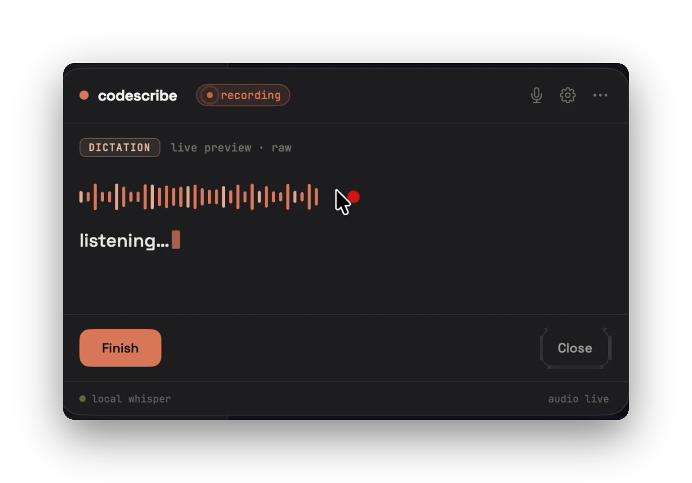

# ⌜ x9bus ⌟

[](Cargo.toml)
[](https://github.com/vetcoders/codescribe/releases/latest)
[](LICENSE)
[](https://github.com/vetcoders/codescribe/actions/workflows/rust.yml)
[](https://codescribe.vetcoders.io/)

**Native macOS dictation and voice conversations with agents.**

<p align="center">
  
</p>

[Download](https://codescribe.vetcoders.io/) ·
[User guide](docs/guide/README.md) ·
[Online guide](https://codescribe.vetcoders.io/guide/) ·
[Releases](https://github.com/vetcoders/codescribe/releases)

x9bus turns speech into text, displays it in a floating overlay and delivers
it to the destination you select. It also connects existing coding-agent
conversations to numbered channels, with written messages, attachments and
spoken replies. A separate built-in Agent provides its own model, history and
tools.

## Start using x9bus

1. Download a package from the website or GitHub Releases, copy the app to
   Applications and launch it from Finder or Spotlight.
2. Follow **Settings → Creator** for permissions. Check **Audio** for the input
   device and **Dictation → Engine** for recognition.
3. Hold **Fn/Globe**, speak a short sentence, then release. Review the result
   and the configured paste policy before relying on delivery to another app.

A packaged app does not require Rust or Xcode. Continue with the
[Quick Start](docs/guide/QUICKSTART.md) or
[installation guide](docs/guide/installation.md).

## Choose recognition, formatting and destination

| Choice             | Available paths                                                                                                           |
| ------------------ | ------------------------------------------------------------------------------------------------------------------------- |
| Speech recognition | **Apple only** (fresh-install default), **Local power** (local Whisper), **Cloud** (online STT with audio-egress consent) |
| Text formatting    | **Off / Correction / Smart** automatically; **Max** is an explicit per-take Agent consultation                            |
| Destination        | Another app under the selected paste policy, the built-in Agent, or an explicitly chosen channel/audience                 |

Apple only does not require downloading Whisper. For Local power, use
**Dictation → Whisper** to download and validate a model. A selected mode,
installed model and loaded recognizer are separate states. Developer options
can add recognition observations or acoustic admission; they are not a required
relay through every engine.

Local recognition can run without a cloud AI service once its dependencies and
permissions are ready. Formatting, remote agents, cloud transcription, speech
synthesis and update checks have separate network boundaries. See
[Privacy & Security](docs/guide/privacy.md).

Live recognition can revise text. A successful processing status is not proof
that every word was preserved. Review names, numbers and content inferred from
quiet audio; AI formatting does not replace comparison with the original take.

## Conversations and channels

**Show Agent** opens x9bus's built-in assistant. Configure its model,
workspace and tool permissions in **Settings → Agent**, and accounts/keys in
**Providers**.

For an existing external session, connect its x9bus integration under a
name and channel **1–9**. The main roster, compact navigation and floating agent
cards are views of those same conversations. The numbered rail remains an
entry point when the sidebar is narrow. A detached agent retains its roster
entry so you can bring its existing window forward.

**0 · All** is a shared channel with audience rules. **Your inbox (10)** collects
messages explicitly addressed to you. Neither means “select every agent”.
Viewing a conversation, choosing written recipients and choosing a microphone
destination are distinct actions.

The composer's recipient menu supports one or several agents. **Sync** shares
text and attachment drafts across the selected group while retaining private
drafts. Inspect recipients before sending. Published, queued and read/ACK are
different states; an ACK is not completion of the requested work.

See [Chat & Overlay](docs/guide/chat-overlay.md) for recipient selection, floating
cards, delivery states and attachment previews. **Markup for image attachments
is nightly-only.** This guide follows development source; your installed public
release can have an earlier interface.

### Connect an external agent

Use the matching x9bus bus plugin package and the client's setup flow.
Installation alone does not attach a conversation or prove that a running client
loaded the update. Keep the session's identity, lease, channel and preferences
when reconnecting it.

| Client       | Setup and delivery contract                                                                                   |
| ------------ | ------------------------------------------------------------------------------------------------------------- |
| Local Codex  | [Codex plugin](docs/OPENAI_PLUGIN.md): local MCP, owned mailbox read/ACK/reply and native queue wake          |
| Claude Code  | [Claude Code plugin](docs/CLAUDE_CODE_PLUGIN.md): connection in the current conversation and hook-driven wake |
| Junie        | [Junie plugin](docs/JUNIE_PLUGIN.md): native extension and documented wait limits                             |
| OMP          | [OMP plugin](docs/OMP_PLUGIN.md): plugin and between-turn wake                                                |
| Remote agent | [Agent MCP](docs/AGENT_MCP.md): explicit reviewed identity, capabilities and transport                        |

For a source installation, `make install-bus` updates managed helpers and
selected integrations after the complete app publisher is installed. It does
not replace the app or connect every conversation. Follow the relevant client
guide rather than borrowing another provider's hooks.

## Settings and help

- [Settings reference](docs/guide/settings.md): current sections, provider/model
  selection, hotkeys, microphones, tools and retention.
- [Troubleshooting](docs/guide/troubleshooting.md): preserve takes and drafts,
  distinguish recognition from delivery, and collect a useful report.
- [CLI guide](docs/CLI.md): file transcription and the app-owned live transcript.
- [Release notes](https://github.com/vetcoders/codescribe/releases): published
  artifacts and build-specific requirements.

Check the installed version/build in **Settings → User** after reopening an
update. The source version, installed bundle and loaded process are different
evidence. A source change does not publish or certify an app.

## Build from source

Use the [developer installation and launch guide](docs/INSTALLATION.md) for
prerequisites, resources, signing, permissions and the supported LaunchServices
path. The Rust core, UniFFI bridge and native SwiftUI app are built together.

```sh
# Optimized local app bundle; this is not a distribution release.
make app PROFILE=local-release

# Build and install to /Applications; the running app keeps working and is
# swapped at its first idle moment, never while you record or compose.
make install-app
```

Do not terminate a recording or an in-flight agent request to make an install
pass. Follow the idle-safe install/restart contract in
[RESTART_IF_IDLE.md](docs/RESTART_IF_IDLE.md). Signed distribution packaging is a
separate release operation.

## Architecture and contribution

| Responsibility             | Owner                                                      |
| -------------------------- | ---------------------------------------------------------- |
| Microphone                 | `RecordingController` in `app/controller/mod.rs`           |
| Spoken occurrence identity | `core/pipeline/acoustic_ledger.rs`                         |
| Transcript document        | `TranscriptReducer` in `app/presentation/emitter.rs`       |
| Transcript bus             | Observer in `app/presentation/transcript_bus.rs`           |
| Delivery routing           | `app/controller/delivery_route.rs`                         |
| Runtime configuration      | `settings.json` → loader → recording snapshot              |
| Native presentation        | `macos/`, through generated UniFFI bindings from `bridge/` |

The overlay and bus project committed transcript state; neither owns a second
transcript document. Read [AGENTS.md](AGENTS.md) and the contracts before changing
these boundaries:

[Architecture](docs/ARCHITECTURE.md) ·
[STT](docs/STT_CONTRACT.md) ·
[Transcript bus](docs/TRANSCRIPT_BUS.md) ·
[Delivery](docs/DELIVERY_ROUTE.md) ·
[Hotkeys](docs/HOTKEYS_CONTRACT.md) ·
[Configuration](docs/CONFIG.md) ·
[Environment registry](docs/ENV_REGISTRY.toml) ·
[Localization](docs/LOCALIZATION.md)

The designated integrator runs `make check`, `make verify` and `make test-swift`
on the recorded candidate. Bridge API changes require `make app-bindings`; do
not edit generated Swift bindings by hand. Worktrees share the main Cargo
target; direct Cargo use requires both absolute build-directory variables and
the source guard described in AGENTS.md. Source-only workers follow
[COMPILE_EMBARGO.md](docs/COMPILE_EMBARGO.md).

Green gates do not establish live microphone-to-delivery behavior or publish a
release. Use the [public release checklist](docs/PUBLIC_RELEASE_CHECKLIST.md)
and preserve the distinction between source, built artifact, installation and
loaded runtime.

## License

x9bus is licensed under the Functional Source License 1.1, ALv2 Future
License (FSL-1.1-ALv2).

This is a Fair Source / source-available license while the current FSL terms
apply. You may read, fork, build, and modify the source for permitted purposes
including personal use, education, research, and professional services.
Competing Use is not permitted: do not make codescribe available as a
commercial product or service that substitutes for codescribe.

Each released version automatically converts to Apache-2.0 two years after the
date we make that version available. See [`LICENSE`](LICENSE) and
<https://fsl.software> for the full terms.

---

**𝚅𝚒𝚋𝚎𝚌𝚛𝚊𝚏𝚝𝚎𝚍. with AI Agents by Vetcoders (c)2024-2026 LibraxisAI**
