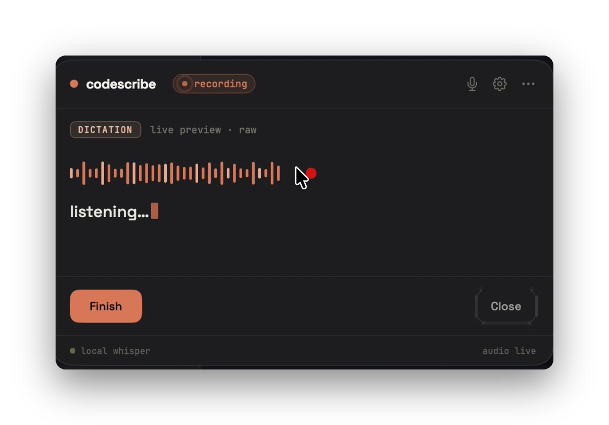
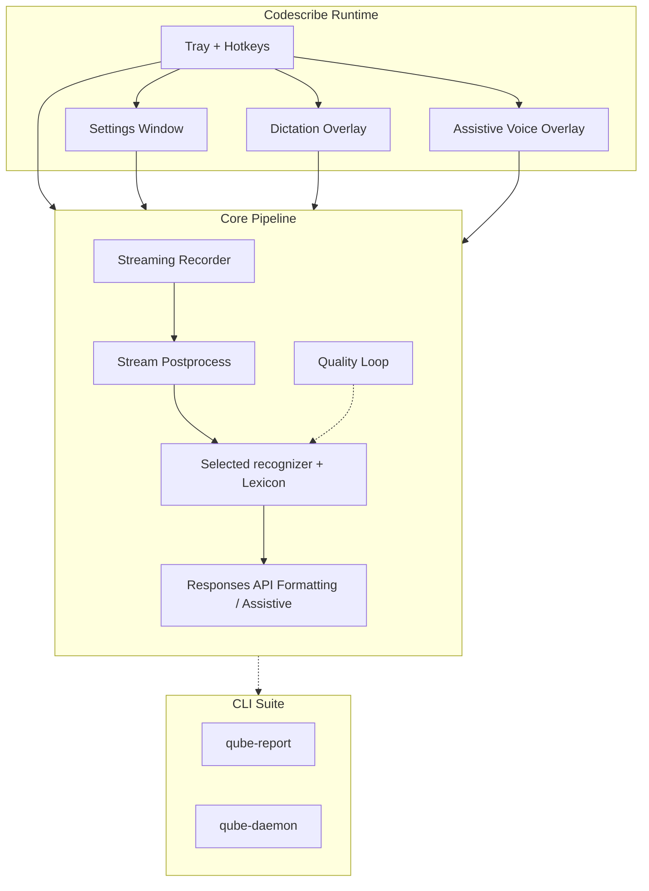
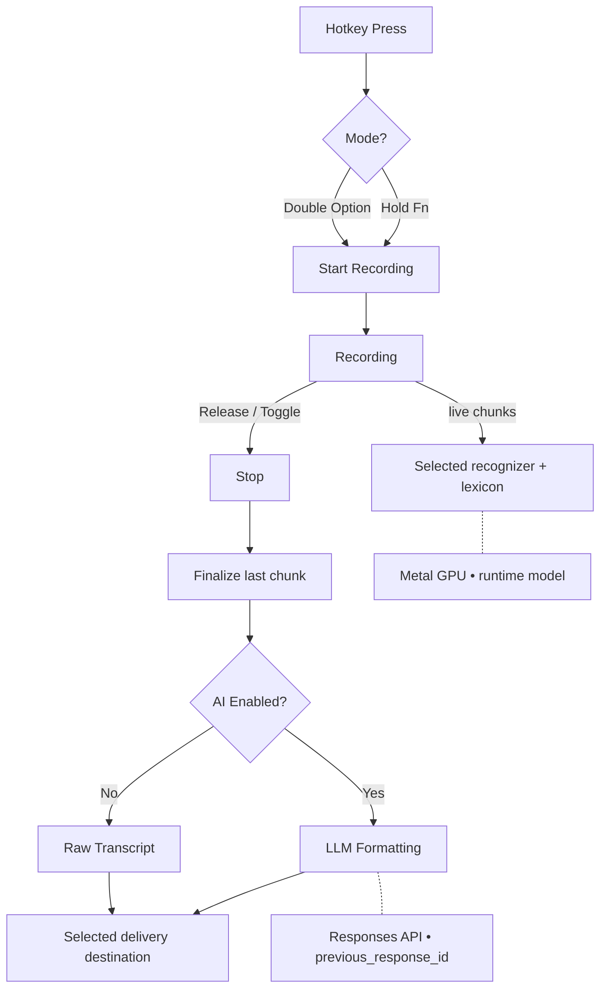

# ⌜ Codescribe ⌟

[](Cargo.toml)
[](https://github.com/vetcoders/codescribe/releases/latest)
[](LICENSE)
[](https://github.com/vetcoders/codescribe/actions/workflows/rust.yml)
[](https://codescribe.vetcoders.io/)

**Native macOS dictation and voice conversations with agents.**

<p align="center">
  
</p>

> **Pierwszy raz z Codescribe? [Otwórz przewodnik krok po kroku online](https://codescribe.vetcoders.io/guide/) lub [lokalny plik HTML](docs/codescribe-step-by-step-tutorial.html).**
> Główny przewodnik użytkownika: instalacja, widget mini/midi/full, uprawnienia, mikrofon,
> kanały agentów 1–9, statusy odbioru i pierwsze dyktowanie. Działa także w 100% offline.
>
> **New to Codescribe? [Open the step-by-step guide](https://codescribe.vetcoders.io/guide/).**
> This README covers the repository, source installation, and developer contracts.

## Overview

Codescribe records dictation from a hotkey and shows a live transcript in a
floating overlay. Delivery follows the destination and paste policy you select.
Recognition runs on-device by default. And dictation is only half
of it: nine numbered voice channels connect your microphone straight to AI
agent sessions over a local bus — speak to an agent in its terminal, and it
answers back in its own voice. The app is a SwiftUI shell over a Rust engine,
with two explicit surfaces: settings and overlays.

Choose Apple only, Local power (Whisper), or Cloud in Settings. A fresh install
uses Apple only. By default the selected recognizer supplies the transcript
directly; Apple live recognition alongside Local power or Cloud, and seal-ledger
admission of words against measured audio, are separate developer options.
They are not an obligatory four-layer relay. The lexicon applies configured
corrections, and full-file retranscription is a separate action. Cloud STT
requires audio-egress consent. AI formatting and assistive mode use OpenAI Responses API (`/v1/responses`) by default, configured in
Settings or `~/.codescribe/.env`.



> **Live text can change:** the preview contains recognition hypotheses, and
> finishing a take can revise them. Recognition errors and words inferred from
> quiet audio remain known problems; the audio guards do not establish perfect
> transcription. Review the text before relying on it.

> **Development source:** [Cargo.toml](Cargo.toml) records the source version.
> A version bump does not publish an app or certify its behavior. Published artifacts are
> listed separately on [GitHub Releases](https://github.com/vetcoders/codescribe/releases/latest).

See: [`docs/WHISPER_LIVE.md`](docs/WHISPER_LIVE.md) | [`docs/ARCHITECTURE.md`](docs/ARCHITECTURE.md)

### Codescribe plugin for Claude Code, Junie and OMP

One plugin, installed with the helpers by `make install-bus`, connects the
conversation you are in to a named channel. All three clients add the same local
marketplace at `~/.codescribe/agent-bridge/runtime/plugins`.

- **Claude Code:** `/plugin marketplace add ~/.codescribe/agent-bridge/runtime/plugins`,
  `/plugin install codescribe@codescribe`, then `/codescribe roman 3`. The turn ends
  after connecting; a background `Stop` hook wakes the conversation for each new
  message, with no model turn during silence. See [Claude Code](docs/CLAUDE_CODE_PLUGIN.md).
- **Junie:** `/extensions marketplace add ~/.codescribe/agent-bridge/runtime/plugins`,
  `/extensions install codescribe`, then `/codescribe junie 6`. Native MCP waits bring
  messages into the same conversation during an active reception task. Junie
  release 26.10.5 limits each wait to three minutes; indefinite idle wakeup is not
  yet established there. See [Junie](docs/JUNIE_PLUGIN.md).
- **OMP (oh-my-pi):** `omp plugin marketplace add ~/.codescribe/agent-bridge/runtime/plugins`,
  `omp plugin install codescribe@codescribe`, then `/codescribe leon 4` inside `omp`. The
  bundled extension holds `cs-bus --omp-wake` between turns and starts a turn for each
  new message, with no model turn during silence. See [OMP](docs/OMP_PLUGIN.md).
- **Any remote agent:** an agent that does not run on this machine joins the same
  channels over MCP 2.0 instead of a plugin, with its identity and capabilities
  fixed by a locally reviewed scope file. See [Agent MCP](docs/AGENT_MCP.md).

## OpenAI Provider

Codescribe uses **OpenAI Responses API** (`/v1/responses`) by default for AI formatting and assistive mode.

### Default Setup

Put your OpenAI API key in Settings. Codescribe stores it in macOS Keychain and applies it to both AI modes:

```env
# ~/.codescribe/.env — each lane picks a provider and a model. The endpoint is
# the provider's own and cannot be overridden; the key lives in Settings ›
# Providers (macOS Keychain), with LLM_OPENAI_API_KEY / LLM_XAI_API_KEY /
# LLM_ANTHROPIC_API_KEY as an env fallback.

# Formatting mode / cleanup pass
LLM_FORMATTING_PROVIDER=openai-responses   # openai-responses | anthropic-messages | xai-responses
LLM_FORMATTING_MODEL=gpt-4.1

# Assistive mode / agent chat
LLM_ASSISTIVE_PROVIDER=openai-responses
LLM_ASSISTIVE_MODEL=gpt-5.5

# Retired and ignored (one warning at start): LLM_ENDPOINT, LLM_MODEL,
# LLM_FORMATTING_ENDPOINT, LLM_ASSISTIVE_ENDPOINT, LLM_API_KEY,
# LLM_FORMATTING_API_KEY, LLM_ASSISTIVE_API_KEY.
```

For the exact resolver used by formatting, assistive, and the agent provider —
including precedence, reset/unset behavior, endpoint normalization, and
key-optional local endpoints — see [`docs/lane-truth.md`](docs/lane-truth.md).

> **Note:** All requests use `previous_response_id` for conversation chaining. Context persists across transcriptions.

### MCP Extension Path

Codescribe can load custom MCP servers from `~/.codescribe/mcp.json`. That keeps the free product useful with user-owned tools today, while leaving room for first-party Pro integrations such as AICX and Loctree later.

## Features

- **Agent voice channels** — nine numbered channels deliver spoken takes into live agent sessions (Claude Code, Codex, and friends) over a local bus; agents reply in their own TTS voices
- **Whisper Live** — Local power decodes bounded windows during recording; finishing the take also waits for outstanding work within its stop budget
- **Rust core + SwiftUI app** — Native macOS SwiftUI shell over the Rust engine through UniFFI, with candle-core + Metal GPU
- **Slim DMG** — Published releases embed Silero VAD only; Whisper is downloaded from Settings → Dictation or HF cache. A `_full` build that also embeds Whisper for fully offline installs is a local build option (`make release-full`), not a published download.
- **Stream postprocess** — semantic gating + cleanup of live chunks before final output
- **IPC Server** — Stable runtime interface for GUI/clients
- **Quality Loop + Report** — Automated quality scoring and batch reports
- **Qube CLI tools** — `qube-report` and `qube-daemon` from `bin/qube_report.rs` / `bin/qube_daemon.rs`
- **Metal GPU Acceleration** — Hardware-accelerated inference on Apple Silicon
- **System Tray App** — Minimal menu-bar presence with animated status glyphs
- **Global Hotkeys** — Hold Fn (default) or double‑tap Option to record
- **OpenAI Responses by default** — Formatting uses `gpt-4.1`; Assistive uses `gpt-5.5`
- **Custom MCP Servers** — Add your own MCP tools through `~/.codescribe/mcp.json`
- **AI Formatting** — Optional post-processing via Responses API
- **Slug Filenames** — Transcripts named with first 3 words for easy identification

## Tech Stack

| Component         | Technology                        | Purpose                        |
| ----------------- | --------------------------------- | ------------------------------ |
| Language          | Rust 2024 Edition                 | Native performance             |
| ML Framework      | candle-core + candle-transformers | Whisper inference              |
| GPU Acceleration  | Metal (Apple Silicon)             | Hardware-accelerated STT       |
| macOS interface   | SwiftUI + AppKit + UniFFI         | Menu bar, windows, Rust bridge |
| Hotkeys           | CGEventTap (core-graphics)        | Global key detection           |
| Audio             | cpal + hound + symphonia          | Recording & format support     |
| HTTP Client       | reqwest                           | LLM API calls                  |
| Agent / formatter | Provider HTTP APIs                | Configured AI lanes            |
| Security          | cap-std                           | Path safety hardening          |

## Installation

### Prerequisites

- **macOS 14+** (Sonoma or later)
- **Apple Silicon** (M1, M2, M3, or later)
- **Rust Toolchain** (1.94+; the workspace declares this MSRV) — source builds only

### Install from Source

```bash
# Clone the repository
git clone https://github.com/vetcoders/codescribe.git
cd codescribe

# Install the hook runner once (required for local commit/push gates)
pipx install pre-commit

# Build an optimized local SwiftUI app
make app PROFILE=local-release

# Install the app bundle into /Applications
make install-app

# Read the source version (this does not inspect the installed app)
make version
```

### Install via Release DMG

No toolchain needed. Download the newest published build from
[codescribe.vetcoders.io](https://codescribe.vetcoders.io/#install) or
[GitHub Releases](https://github.com/vetcoders/codescribe/releases/latest):

1. Download `Codescribe.dmg`. Each release also carries the same bytes as
   `Codescribe_<version>-<builddate>-<sha>.dmg`, plus `.sha256` checksums.
2. Drag `Codescribe.app` into `Applications`.
3. Follow the first-launch setup; the
   [user guide](https://codescribe.vetcoders.io/guide/) covers permissions,
   the widget and agent channels.
4. Dictation works without a license key. The built-in Agent chat needs one:
   get a free open-beta key at
   [codescribe.vetcoders.io/license](https://codescribe.vetcoders.io/license/)
   and paste it into **Settings → License**. Nothing is sold today.

Installed copies update in-app through Sparkle from
`https://codescribe.vetcoders.io/appcast.xml`.

> The release pipeline signs each DMG with Developer ID, notarizes and
> staples it, and runs the fail-closed `verify-dmg` payload check before
> upload. To check a download yourself, compare `shasum -a 256 Codescribe.dmg`
> with the digest in `Codescribe.dmg.sha256`, then run
> `spctl -a -t open --context context:primary-signature -v Codescribe.dmg`.

### Build Options

```bash
make app                # Debug SwiftUI app build
make app PROFILE=local-release # Optimized local SwiftUI app build
make install-app        # Build + install macOS .app into /Applications
make release-qube       # Build qube CLI tools
make install            # Install qube CLI tools + repo-local git hooks
```

## Quick Start

```bash
# Build and install the app
make install-app

# Launch installed app bundle
make start

# Open/create config file
make config
# or: edit ~/.codescribe/.env directly

# View app logs
make logs
```

## Default Hotkeys (macOS)

- **Dictation**: hold your configured modifier (default: **Hold Fn/Globe**) → release to finish; automatic paste follows the selected paste policy
- **Formatting**: **Double‑tap Left Option** → recording without holding a key; formatting depends on AI settings and provider access
- **Assistive (Agent)**: **Double‑tap Right Option** → voice‑chat overlay + agent response, separate from external numbered channels

Hotkeys are configured in **Settings → Hotkeys** (Polish: **Ustawienia → Skróty**). Double‑tap modes start recording without holding a key and stop on the next double‑tap. Delivery and AI processing depend on the selected mode and settings.

## Settings & Secrets

- GUI settings: `~/Library/Application Support/Codescribe/settings.json`
- API keys: macOS Keychain (`com.vetcoders.codescribe`)
- Power‑user overrides: `~/.codescribe/.env`

## How It Works



### Transcription Pipeline

The selected ASR mode determines the recognizer. Apple only enables Apple live
recognition; Local power enables local Whisper; Cloud uses a consented remote
session. In the default direct path, recognizer text goes through the lexicon
to the presentation reducer. Silero observes speech and pauses on the capture
clock. Optional formatting uses the configured formatting lane.

Developer builds also expose independent Apple-live and seal-ledger switches.
With ledger admission enabled, observations must qualify against acoustic
occurrences before they can change the document. The detailed layered contracts
describe that path; they do not mean every default recording runs every layer.
The reducer owns the document projected into the overlay, history and delivery.
Full-file retranscription is an explicit action.

### Recording Modes

| Mode                  | Trigger                   | Description                                |
| --------------------- | ------------------------- | ------------------------------------------ |
| **Dictation**         | Hold `Fn/Globe` (default) | Fast transcript (AI optional), auto‑paste  |
| **Formatting**        | Double‑tap `Left Option`  | AI formatting pass, auto‑paste             |
| **Assistive (Agent)** | Double‑tap `Right Option` | Agent chat with optional selection context |

See [`docs/guide/modes.md`](docs/guide/modes.md) for detailed mode descriptions.

## Configuration

GUI settings live in `settings.json`, secrets in Keychain, and power‑user overrides in `~/.codescribe/.env`.

```bash
# Open config helper (creates ~/.codescribe/.env if missing)
make config
```

### Environment Variables

```env
# STT (Speech-to-Text)
WHISPER_LANGUAGE=auto                # auto | pl | en
# CODESCRIBE_MODEL_PATH=             # Override runtime Whisper model lookup

# Hotkeys behavior
# Per-mode bindings live in Settings -> Hotkeys (settings.json)
HOLD_EXCLUSIVE=1                     # ignore extra modifiers during hold
HOLD_START_DELAY_MS=800              # Delay before recording starts
DOUBLE_TAP_INTERVAL_MS=200           # Toggle gesture timing
TOGGLE_SILENCE_SEC=5.0               # Apple epoch rest after this much silence (next recording)

# AI Formatting
AI_FORMATTING_ENABLED=1              # 1=format via LLM, 0=raw transcript

# LLM lanes: a provider and a model per lane. The endpoint is the provider's
# own; keys live in Settings › Providers (Keychain), env is only a fallback
# (LLM_OPENAI_API_KEY, LLM_XAI_API_KEY, LLM_ANTHROPIC_API_KEY).
LLM_FORMATTING_PROVIDER=openai-responses   # openai-responses | anthropic-messages | xai-responses
LLM_FORMATTING_MODEL=gpt-4.1
LLM_ASSISTIVE_PROVIDER=openai-responses
LLM_ASSISTIVE_MODEL=gpt-5.5
# Retired, ignored with one warning: LLM_ENDPOINT, LLM_MODEL, LLM_*_ENDPOINT,
# LLM_API_KEY, LLM_FORMATTING_API_KEY, LLM_ASSISTIVE_API_KEY.

# History
HISTORY_ENABLED=1                    # Save transcripts
DUMP_AUDIO_LOGS=0                    # 1=save .wav paired with .txt

# Audio
BEEP_ON_START=1
SOUND_VOLUME=0.5
# AUDIO_INPUT_DEVICE=                # Specific device name

# Logging
LOG_LEVEL=INFO                       # TRACE | DEBUG | INFO | WARN | ERROR
```

See `.env.example` for complete reference.

## Runtime and CLI Reference

### `Codescribe.app`

The user-facing app is the native SwiftUI bundle built by `make app` and installed with `make install-app`. It runs as a menu-bar app with global hotkeys and talks to the Rust core through the UniFFI bridge.

### Qube Tools

The repo still ships Rust CLI utilities for batch quality work:

```bash
qube-report --help
qube-daemon --help
```

## Model

Local power uses the Whisper model selected in Settings. The default download
is **whisper-large-v3-turbo** (mlx-community, fp16):

- 4-layer turbo architecture (vs 32 layers in full model)
- fp16 weights (~1.6 GB): load without q8→F32 dequantization; quantized Whisper
  payloads are rejected before engine load
- Metal GPU acceleration

### Runtime Whisper (Current)

**Daily public builds keep large weights out of the artifact.** `make release`, `make dmg` / `dmg-signed`, and `make release-standard` embed only **Silero VAD** in the Rust engine. **Whisper is not baked in** (~900 MB–1.5 GB saved) — install local Candle Whisper from **Settings → Dictation → Download Whisper**, or run `make download-model`. **MiniLM is not bundled either** (~471 MB saved): no runtime path loads it, so it ships only when a build asks with `./scripts/build-dmg.sh --bundle-embedder`. The e2e round-trip and lexicon-calibration lanes resolve it from the HF cache after `make download-embedder`.

Optional fat SKU (offline / curiosity): `make release-full` or `CODESCRIBE_EMBED_WHISPER=1` / `make release-codescribe-embedded`.

Runtime resolution when Whisper is not embedded:

1. `CODESCRIBE_MODEL_PATH` environment variable
2. `~/.codescribe/models/whisper-large-v3-turbo/` (fp16 default)
3. A complete Hugging Face snapshot configured by repo id, followed by the
   default `mlx-community/whisper-large-v3-turbo` snapshot

The mlx-community repo ships only `config.json` + `weights.safetensors`;
the download paths compose `tokenizer.json` from the matching official OpenAI
Transformers repo and `mel_filters.npz` from a checksum-pinned OpenAI Whisper
asset. The resulting directory is validated as loader-compatible fp16/fp32
before resolution.
The shared bundle validator parses the config, applies bounded architecture
resource limits, requires every runtime prompt/control token to fit the
configured vocabulary, and uses the same automatic-language candidate logic as
the decoder. It verifies the pinned mel SHA-256 and validates every
required Whisper tensor name and shape plus the complete safetensors tensor
table, exact consumed tensor set, bounded alignment metadata, dtype allowlist,
mapped-name uniqueness, offsets, and file length. The
disk loader applies this complete gate before mmap or model construction.
Config and tokenizer JSON are size-bounded before parsing, and vocabulary size
is capped at the largest supported official Whisper vocabulary.
Downloads and warm-cache
copies are written to `.partial` files and promoted only after per-file
validation; an invalid destination is repaired on the next Download action
instead of being accepted as complete. Config validation requires the complete
MLX Whisper architecture
used by the loader (including matching audio/text state widths and compatible
attention heads, a decode context that leaves room for output, and broad layer
count safety fences). Matching audio/text state widths are bounded to the
official Whisper range `4..=1280` before quadratic model allocations. Decoder context is bounded to the supported `5..=448`
range before its quadratic causal mask is allocated. Audio context must equal the 1500 positions consumed by
the supported 30-second Whisper window; shorter contexts would silently truncate
audio. The pinned mel filterbank is size-checked and hashed through a bounded
stream before use; missing dimensions are never replaced
with runtime defaults.
Warm-cache repair checks older snapshots when the newest config, weights, or
tokenizer is invalid, and returns as soon as the composed destination validates,
preserving an already-valid installed model pair when only a smaller artifact
needs repair and avoiding a weights-sized temporary copy. Optional timestamp
tokens are accepted only as a complete contiguous 20 ms range from 0.00 to 30.00 seconds.

`CODESCRIBE_EMBED_EMBEDDER=1` is an explicit fat/debug path that compiles MiniLM into Rust artifacts. Normal builds resolve MiniLM from the signed app resource or HF cache. `CODESCRIBE_NO_EMBED=1` disables every optional binary embed; Silero remains embedded.

Model files required:

- `config.json`
- `weights.safetensors`
- `tokenizer.json`
- `mel_filters.npz`

## Architecture

```text
Codescribe/
├── core/                      # Portable pipeline, STT, config, quality
├── app/                       # Rust engine library (macOS)
│   ├── agent/                 # Assistive agent + tools
│   ├── controller/            # Recording/transcription orchestration
│   ├── os/                    # Hotkeys, permissions, clipboard, thermal
│   └── presentation/          # Overlay delta/typing emitter
├── bridge/                    # UniFFI bridge (Rust <-> Swift)
├── macos/Codescribe/          # SwiftUI front-end
│   ├── Screens/               # Tray, Settings, Overlay, AgentChat
│   ├── DesignSystem/          # Tokens, typography, components
│   └── Bridge/                # Generated UniFFI Swift bindings
├── bin/                       # CLI entry points (qube-report, qube-daemon)
├── tests/                     # Integration + E2E tests
└── docs/                      # Product + technical docs
```

## Development

```bash
# Clone and setup
git clone https://github.com/vetcoders/codescribe.git
cd codescribe

# Development app build with explicit runtime Whisper fallback
CODESCRIBE_MODEL_PATH=~/.codescribe/models/whisper-large-v3-turbo make app PROFILE=debug
open macos/build/Build/Products/Debug/Codescribe.app

# Quality checks
make lint           # clippy + fmt check
make test           # Unit + integration tests
make check          # Full quality gate

# Formatting
make format         # cargo fmt

```

### Makefile Targets

```
make app              # Debug SwiftUI app build
make app PROFILE=local-release # Optimized local SwiftUI app build
make install-app      # Local-release install to /Applications
make release-stable   # Everyday: notarize slim DMG + install that stapled .app
make release-qube     # Build qube CLI tools
make install          # Install qube CLI tools + repo-local hooks
make release-dmgs     # Build both signed + notarized release DMGs
make config           # Edit ~/.codescribe/.env
make start            # Launch Codescribe.app
make stop             # Stop running instance
make logs             # View logs
make lint             # Clippy + format check
make test             # Run tests
make check            # Full quality gate
make download-model   # Download Whisper model
```

## Code Quality

| Tool           | Purpose    | Config            |
| -------------- | ---------- | ----------------- |
| **Clippy**     | Linting    | `-D warnings`     |
| **rustfmt**    | Formatting | Rust 2024 edition |
| **cargo test** | Testing    | Unit + E2E        |

## Permissions

Permissions apply to the features you use:

- **Microphone** — Audio recording
- **Speech Recognition** — On-device Apple Speech dictation
- **Accessibility** — Inserting text into other applications
- **Input Monitoring** — Keyboard event capture
- **Screen Recording** — Screen context for the Agent
- **Full Disk Access** — Optional access to protected files for the Agent

The current setup completion check also includes Screen Recording, even for Basic mode; Full Disk Access is optional.
See the [user tutorial](docs/codescribe-step-by-step-tutorial.html#permissions) for the permission steps and the distinction between closing the wizard and recording readiness. The selected transcription mode determines whether a local Whisper model is needed. A microphone calibration is needed only with seal-ledger admission, which is off by default (see Recording readiness in [the Settings guide](docs/guide/settings.md)).

## Current Focus

- Keep the VAD auto-stop path honest and fully integrated before presenting it as the default hands-off mode.
- Preserve the explicit split between settings, dictation overlay, and assistive overlay.
- Ship the macOS distribution path cleanly: bundle, sign, and notarize the DMG story.

See [`docs/PUBLIC_RELEASE_CHECKLIST.md`](docs/PUBLIC_RELEASE_CHECKLIST.md) for the public launch gate.

## License

Codescribe is licensed under the Functional Source License 1.1, ALv2 Future
License (FSL-1.1-ALv2).

This is a Fair Source / source-available license while the current FSL terms
apply. You may read, fork, build, and modify the source for permitted purposes
including personal use, education, research, and professional services.
Competing Use is not permitted: do not make codescribe available as a
commercial product or service that substitutes for codescribe.

Each released version automatically converts to Apache-2.0 two years after the
date we make that version available. See [`LICENSE`](LICENSE) and
<https://fsl.software> for the full terms.

---

**𝚅𝚒𝚋𝚎𝚌𝚛𝚊𝚏𝚝𝚎𝚍. with AI Agents by Vetcoders (c)2024-2026 LibraxisAI**
