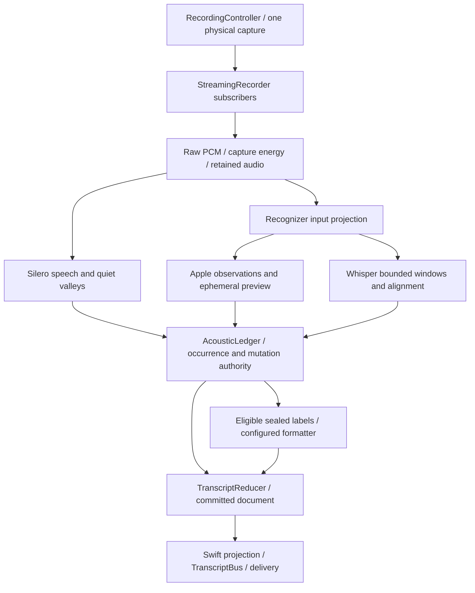

# Engine map

Source checkpoint: **2026-10-11**, `04fc280c753a379ef33755dc84349a06310a3dc0`,
0.17.0/build 801. This map names the runtime stages so a new contributor can
locate a decision without reconstructing the development conversations.
It describes source wiring; the [dated evidence](#dated-evidence-and-open-work)
separates that from test, installation and native quality results.

Read [STT_CONTRACT.md](STT_CONTRACT.md) for detailed routing and
[THE_ENGINE_CONTRACT.md](THE_ENGINE_CONTRACT.md) for product invariants.
[ARCHITECTURE.md](ARCHITECTURE.md) covers the wider application.

## One capture clock, one ledger, one document

Physical occurrence identity is `(session, capture_epoch, sample_start, sample_end)`. Observation identity additionally names producer, request and
generation. Equal words at different physical ranges remain different
occurrences. A provider's text, a formatter result, a UI callback or a Bus row
cannot invent that identity.

## Stage catalogue and source owners

| Stage                          | Responsibility and boundary                                                                                                                                                                                                                           | Source                                                                                                                                                                                                  |
| ------------------------------ | ----------------------------------------------------------------------------------------------------------------------------------------------------------------------------------------------------------------------------------------------------- | ------------------------------------------------------------------------------------------------------------------------------------------------------------------------------------------------------- |
| Capture and intent             | `RecordingController` starts/stops the take. One physical stream is refcounted over subscribers; a channel does not open another microphone.                                                                                                          | [controller](../app/controller/mod.rs), [recorder](../core/audio/streaming_recorder.rs), [channel routing](../app/controller/agent_channel.rs)                                                          |
| Configuration                  | Resolve one immutable runtime settings generation; select Layer 1 using `layer1_decision`. UI preferences and a serving receipt answer different questions.                                                                                           | [ASR session](../core/asr_session/mod.rs), [settings loader](../core/config/loader.rs), [settings](../core/config/settings.rs)                                                                          |
| Input projection               | Quiet-capture conditioning can derive recognizer samples with gain/RNNoise. It preserves sample count and coordinates; retained raw PCM stays raw. Replaying the raw WAV is not necessarily replaying the live recognizer input.                      | [speech input](../core/audio/speech_input.rs), [live session](../core/pipeline/streaming/apple_live_session.rs)                                                                                         |
| Speech evidence and owners     | Capture energy and Silero measure speech on the same epoch. Timed Apple phrase ends may close an existing owner at a calibrated quiet valley. Mean energy or a text boundary alone cannot create a word occurrence.                                   | [capture receipt](../core/audio/capture_receipt.rs), [chunker](../core/audio/chunker.rs), [Silero fusion](../core/pipeline/streaming/silero_fusion.rs)                                                  |
| Apple observations             | SFSpeech supplies fast partial/final observations. The Swift bridge forwards real partials rather than synthesizing finals from revisions; Rust retains the open phrase and requires measured valley evidence for a restart.                          | [Swift live recognizer](../core/stt/apple_stt/codescribe-stt-bridge.swift), [Apple live stream](../core/stt/apple_stt/live_stream.rs), [live session](../core/pipeline/streaming/apple_live_session.rs) |
| Layer 1 planning               | `CaptureWindowPlan` offers 9-second windows with a 3-second step and a clipped EOF remainder. The same accounting corridor carries bounded lexical witnesses; provider backpressure does not mint a new grid.                                         | [window plan](../core/pipeline/streaming/layer1_window.rs), [tail provider](../core/stt/tail_provider.rs)                                                                                               |
| Word alignment                 | Whisper attention/DTW yields word pins when valid. The first boundary uses a predictive-attention peak onset estimate; it is not a measured speech onset. Failed alignment remains coarser evidence.                                                  | [word pins](../core/stt/whisper/word_pins.rs), [Whisper engine](../core/stt/whisper/engine.rs)                                                                                                          |
| Admission and lexical disputes | Only the ledger grants corrections, insertions, splits or preservation. Source scope, timing completeness, retained witnesses and admission horizon constrain a late result. Confidence is producer evidence, not a substitute for physical identity. | [ledger](../core/pipeline/acoustic_ledger.rs), [slot operations](../core/pipeline/acoustic_ledger/slot_ops.rs), [word adjudication](../core/pipeline/acoustic_ledger/word_adjudication.rs)              |
| Deterministic shaping          | Dictionary/Light+ affect labels or presentation through admitted paths. Light+ shaping receipts retain source/context provenance; raw acoustic evidence remains distinct.                                                                             | [quality module](../core/quality/mod.rs), [presentation emitter](../app/presentation/emitter.rs)                                                                                                        |
| LLM formatting                 | Selected prompts govern lexical edits and structure. A result is a source-bound derived revision, not evidence of new speech. Max uses grouped Agent consultation.                                                                                    | [formatter](../core/llm/ai_formatting.rs), [captured prompts](../core/config/prompts.rs), [consultation](../core/agent/consultation.rs)                                                                 |
| Document and observers         | `TranscriptReducer` owns committed document versions. Swift paints its projection; `TranscriptBus::publish_revision` observes committed revisions. Preview and diagnostic text do not write delivery.                                                 | [emitter/reducer](../app/presentation/emitter.rs), [Bus](../app/presentation/transcript_bus.rs), [overlay state](../macos/Codescribe/Screens/Overlay/OverlayState.swift)                                |
| Stop and delivery              | Explicit Stop retains real PCM before EOF, closes the owned feed and settles bounded recognizer work. The delivery router selects the destination from explicit intent. A seal refusal remains visible and does not strand microphone lifecycle.      | [recorder](../core/audio/streaming_recorder.rs), [controller](../app/controller/mod.rs), [delivery route](../app/controller/delivery_route.rs)                                                          |

Use Loctree `slice` on the listed source before editing, and `find`/`body` on
the named symbol. These are navigation anchors, not new runtime authorities.

## Why Agent chat and ordinary dictation can differ

The same recognizer implementation does not mean the same take. The capture
feeds have independent session lifecycle, immutable settings snapshots and
ledger/reducer state.

| Capture intent | Silence lifecycle                                | LLM scheduling                                                                                    |
| -------------- | ------------------------------------------------ | ------------------------------------------------------------------------------------------------- |
| `HandsFree`    | Configured utterance silence threshold           | Smart/Correction may format sealed fragments live; Max may consult over grouped sealed fragments. |
| `SingleTurn`   | One explicit take; silence does not end the turn | No live fragment formatting; format once during terminal processing.                              |
| `AgentChannel` | Configured utterance silence threshold           | No LLM formatting; delivers shaped Raw after acoustic refinement.                                 |

`CaptureTurnIntent::schedules_live_formatting`, `formats_once_at_terminal`,
`live_formatter_lane_is_armed` and `live_max_capability` implement this split.
Smart and Correction share the same live scheduling lane; changing between them
does not by itself make one wait for Stop. Max is not inherently terminal-only.

For a causal comparison, preserve the exact PCM, settings generation, source
commit, recognizer input projection, window ranges and output stage. Two text
samples or the same model name do not isolate the difference.

## Explicit Stop and the virtual pause

1. The Stop gesture establishes one fixed deadline. `await_stop_pause` retains
   the selected subscriber's real PCM until `STOP_CAPTURE_GRACE` (1500 ms)
   after that gesture. Repeated Stop or a cancelled waiter cannot renew it.
   Automatic silence, handoff and cleanup do not use this pause.
2. Release that feed. Other subscribers can keep the physical stream alive;
   the closed take does not acquire another subscriber's audio identity.
3. Close recognizer input and collect actual end-finals. The controller's
   recognizer-final wait starts after capture closure, separately from the
   virtual pause. A timed-out or preempted painted prefix must not consume the
   delivery claim intended for the later complete document.
4. Drain already admitted work under the existing useful-refinement deadline.
   Bounded uncovered-PCM repair uses the owned archive; Stop does not run a
   whole-session transcription to replace the document. No new live lexical
   trial is launched once `capture_stopping` is set.
5. Assess terminal acoustic coverage/finality and publish the appropriate
   terminal document or refusal. Light+ may close terminal punctuation without
   reshaping earlier casing, commas and whitespace. Route delivery according
   to the explicit destination; preserve recoverable text/audio on refusal.

The pause is an opportunity to collect evidence, not permission to invent
silence samples or rewrite the entire take. It also does not guarantee admission
of every last word. A five-second useful-refinement drain is not a hard bound on
all native model teardown or end-to-end Stop latency.

## Formatting contract and network boundary

Off skips LLM formatting. Smart/Correction pass the actual text under the
selected sealed prompt. Max invokes Agent consultation. Lexical edits,
repetition handling and restructuring are controlled by prompts; the formatter
does not pre-clean repetitions or veto a result by lexical word order/count.
Provider budgets, exact no-op classification and stale source/revision checks
still apply. They protect execution and attribution, not linguistic policy.

**On-device selection is currently local-first, not local-only.** In
`format_text_with_status_channels_for_policy`, a failed host attempt or missing
registered host formatter proceeds to the configured cloud lane under the same
retry budget. A successful host result does not need that cloud attempt. If no
engine is available, the caller retains source text with a failure disposition.
Do not promise that selecting `format_on_device` prevents all text egress.

Acoustic word order/PCM multiplicity rules still constrain recognizer admission.
Those rules must not be copied into the LLM path as a lexical veto. A formatter
can change presentation without minting acoustic occurrences or claiming that
omitted audio has been recognized.

## How to trace a missing or changed word

| Question                           | First evidence to inspect                                                                                                         |
| ---------------------------------- | --------------------------------------------------------------------------------------------------------------------------------- |
| Did the model say it?              | Producer request, exact decode range, `original_text`, original pins or phrase segments.                                          |
| Did alignment provide word timing? | Alignment reason/context and returned grain. Zero pins must not be interpreted as zero speech.                                    |
| Was it admitted?                   | Ledger mutation/refusal and target source ranges, not merely an `UtteranceFinal` or visible preview.                              |
| Did it survive document assembly?  | Reducer revision, source-bound shaping/formatter receipts and projection.                                                         |
| Was it delivered?                  | Delivery disposition and visible receiver; an archive, Bus row or clipboard write alone is insufficient.                          |
| Was the take complete?             | Session-matched capture energy/Silero extent, coverage debt and terminal ledger receipt. A lifecycle end is not an acoustic seal. |

Keep raw recognition, derived formatting and delivery bytes separately. Trail
`dropped` counts and `evidence_complete=false` limit reconstruction; observed
positive events can prove a particular decision but do not make a lossy trail
a complete replay. See [TRANSCRIPT_BUS.md](TRANSCRIPT_BUS.md) and
[DELIVERY_ROUTE.md](DELIVERY_ROUTE.md).

## Dated evidence and open work

This is a **2026-10-11 checkpoint**, not a moving completion badge.

| Source/check                                             | Result and limit                                                                                                                                                                                                                                  |
| -------------------------------------------------------- | ------------------------------------------------------------------------------------------------------------------------------------------------------------------------------------------------------------------------------------------------- |
| Prefix repair `d64804bea5aaa4df11f13cecafc71e5367d945ca` | A later coarse partial decode no longer retires measured speech before its start. Preregistered five-Iwo prefix case failed 5→2 on `2af7f808`, then preserved five. Full-window five-pin control passes.                                          |
| Core on that cut                                         | 2248 PASS / 3 FAIL / 6 ignored. Two failures reproduced on baseline; unchanged suffix falsifier still fails 5→3. Existing expectations were not weakened.                                                                                         |
| UI `cc7efd00`, final test checkpoint `04fc280c`          | 36 focused resize/reflow tests PASS. Broader 75 cases retain two failing AX-dependent cases/three assertions; baseline cause not established.                                                                                                     |
| Static gates and installation                            | Prefix and UI static checks pass. Build 799 contains prefix repair; build 801 adds resize UI. Installed 801 signature and unsigned main/FFI parity pass. These are not native quality measurements.                                               |
| Earlier broad gates                                      | Canonical `make verify` stopped at 12 structural-instrument failures. The earlier full Swift run had failures; later focused passes are not a replacement full-green claim.                                                                       |
| Native acceptance                                        | No paired native quality/latency acceptance for 801. Founder reports 798 initially felt better; this is useful feedback, not a causal A/B verdict. Mute failure cause remains unproven; the Agent-drawer cursor sample is under UI investigation. |

Receipts from this development round are in the local artifact folders
`lena-phrase-publication` and `astra-overlay-resize-floors`, under
`~/.vibecrafted/artifacts/vetcoders/codescribe/2026_1011/`.
They record exact generations, logs and limitations. A new release should attach
its own receipts rather than silently carrying this checkpoint forward.
