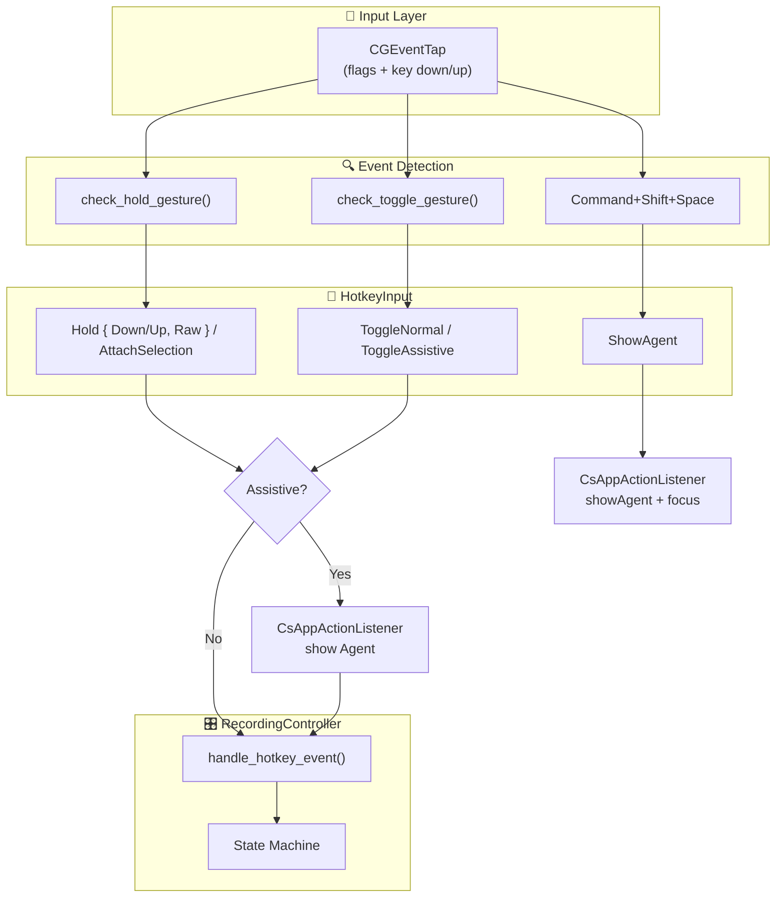
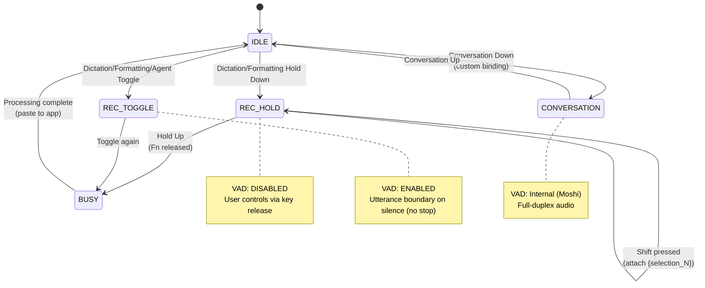
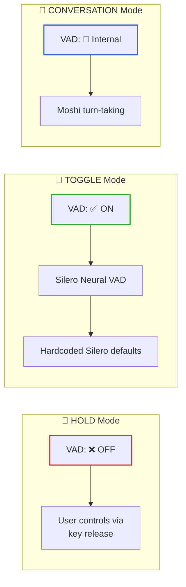
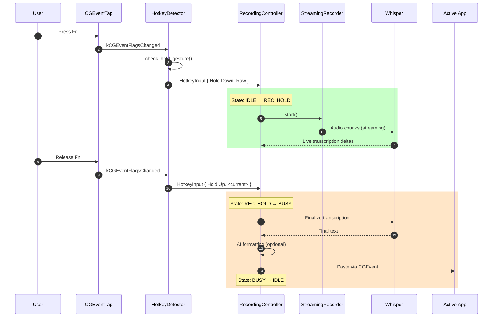
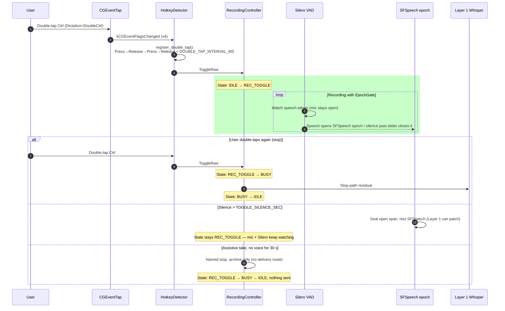
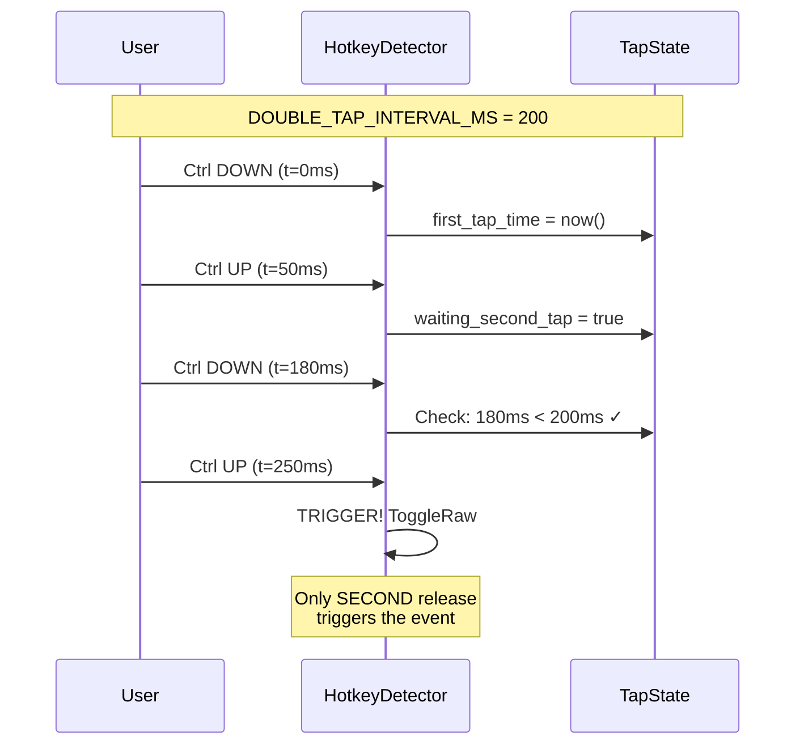

# Hotkeys Contract

## Overlay conversation viewing and speech

The overlay's bar has two sizes, mini and the expanded bar (`midi`); the
expanded overlay is the transcription or Agents window, not a bar size.
Settings → Creator → **Intercom layout** picks Classic (the bar without an
agent map, the default), Horizontal strip (the expanded bar carries the agent
map) or Floating pills (the vertical Intercom; its stacked counter sits beside
the brand in every form). The setting changes presentation only.

Overlay size is selected explicitly. A still click on the bar's empty
background switches mini ↔ the expanded bar in both directions (Monika,
2026-10-30); dragging the background past the 3 pt jitter threshold moves the
panel instead, and a still click on the open window's header folds it to the
expanded bar. Buttons and map chips keep their own actions; the brand dot
closes the overlay. The chevron opens the window from either bar size and
returns the window to mini; transcription and ✦ open their window surfaces.
The upper-right corner is the shared pin: the bar grows leftward, a second
row and the transcript grow downward, with display containment applied when
the full target cannot fit. The chevron's context menu also selects any of
the three modes directly. Mini is not resizable and is as wide as its
content; the expanded bar supports horizontal resize only, which changes its
width and never its mode; regular supports edge and corner resize around that
same pin. Settled native floors are mini 161 × 46 pt (its controls), the
expanded bar's densest layout (below) and regular 320 × 260 pt. Screen
anchors, the saved position and resize gestures reason in a 200 × 46 pt mini
placement strip (`DictationOverlayWindow.miniPlacementSize`); mini is drawn at
that strip's trailing edge. During a drag, the painted frame respects the current form's floor.
Resizing the regular window separately retains the requested gesture size:
on release, requested height of at least 153 pt keeps regular; below that,
requested width below 305 pt selects mini and larger width selects the
expanded bar. Thus release-to-fold remains available from the window without
crushing it during the drag; resizing a bar never changes its mode. The bar
sizes settle to their content; regular retains its manual size above its
readability floor. Moving the window relocates the pin. Pointer entry
and departure preserve that selection. Hover still provides button feedback and
pauses terminal auto-hide; it does not change the capture route or window size.

Mini, left to right, is the brand dot (close), transcription, microphone,
the Agents slot and the chevron (`docs/guide/chat-overlay.md`, "Agent map in
the bar"). It has no waveform, clock or counter and is as wide as its content
(`DictationOverlayWindow.miniNaturalWidth`): 161 pt (32 pt padding, the 9 pt
dot, four 22 pt controls, 8 pt gaps). While the microphone feeds agent
channels mini stays mini; the Agents slot shows the overlapping violet
circled digits of every open channel (`0` for all) and widens with them, and
its press is the Agents press, which in mini stops that capture
(`OverlayState.agentsButtonStopsRecording`). Pointing at ✦ at rest lists the
present agents; a row selects that conversation.

The expanded bar is one 46 pt row: brand, the waveform and clock only while
audio is captured or a take transcribes (`OverlayState.channelMapBarShowsMeter`),
the agent map in the horizontal layout, then transcription, ✦, Pin,
microphone and chevron. `OverlayBarGeometry` decides the map's arrangement
from measured widths: full names under their circles in one row; when they
do not fit, a second 20 pt row (plus a 4 pt gap) holds the map with each name
beside its circle; narrower still, one row with truncated names, then
overlapping circles. Its natural width is one row up to a 520 pt budget, else
two rows; the window and the header use the same geometry
(`DictationOverlayWindow.midiBarGeometry`). A roster change, the meter coming
or going, or channel 0 opening refits the bar in one step at its upper-right
pin. A manual horizontal resize gives the width to the user for the session:
narrower than the natural width, it is kept and the map densifies; wider, it
is kept and grows only when the natural width exceeds it. The floor is the
densest layout. Chip hints read the Agent channel modifier in effect
(`AGENT_CHANNEL_MODIFIER` after the one-key-one-role rule, Ctrl or Fn) and
never assume Ctrl. A chip click is passive selection, like a rail pill; the
vertical layout's counter brings the Intercom group forward. Neither ever
opens or closes a channel's microphone or retargets a running capture. The
map adds no hotkey and no chord of its own.

The overlay's channel menu separates **My dictation**, **0 · All**, and exact
named-agent conversations from the explicit **Capture channels** controls.
Selecting a conversation is passive: it does not open or close the microphone,
change an admitted take's destination, acknowledge an envelope, or replay speech.
Historical conversations retain their provider/session/lease identity and name
after rebinding. Channel 0 remains viewable when capture is closed.

My dictation keeps its native editor mounted across view changes, retaining its
selection, scroll and local revision draft. A view change cancels pending
commit-on-blur admission; explicit transcript actions still use the existing
reducer compare-and-swap path. Conversation messages are selectable read-only
text. Unread reply counts describe viewing only, independently of delivery ACK.

An explicit ordinary hold or toggle start closes active agent capture channels
through their normal hangup path before admitting dictation (Founder delivery
`f3cbd666a0d7d7e61d4d1971`, 2026-10-05).
Each channel releases its PCM feed before dictation admission. Its retained
terminal task then joins and publishes the final receipt; its words are retained.
For hold gestures, handover waits until the existing start delay has elapsed.
A hold key released inside the delay starts no take, and an explicit channel
gesture during the delay (an agents-list click) cancels that pending hold.
The channel modifier never records (one key, one role, below), so a hold or
toggle take is never a channel chord's prefix. A take on another key keeps
running beside a channel opened from the agents list.
The same unified overlay then shows My dictation. The channel silence poll shares
the controller's serial transition lock with this handover. Repeated lifecycle
callbacks do not replace a view the user selected during the admitted capture.

A recording Stop gesture binds the already published capture identity before
waiting for the start transition lock. Key release, the overlay Stop and the
recording toggle join the same retained terminal operation. A start finishing
its admission cannot discard that Stop; timeout leaves its owner running until
settlement. The terminal operation rechecks the captured identity under the
transition lock and never stops a successor. Idle without a published capture
still requires admission to be available before reporting no live take.

Native recording gestures remain FIFO ordered through capture admission. A Stop
acknowledges only after its PCM subscription is released and the capture and
transition locks are free. The same retained terminal operation owns archive
finalization, recognition, reducer publication and delivery; explicit Stop APIs
still wait for its terminal result. `Busy` refuses a new take until the old
foreground retires, while channel gestures can use the released capture slot.
A preempting start waits on the predecessor's foreground settlement receipt,
not merely on a mutex that the terminal drain has released.

Each take archives exactly its own admitted native PCM, even when a channel
keeps the physical microphone open. Releasing the feed freezes its sample count
under the same registry lock as capture admission. A bounded archive queue or
write failure refuses incomplete evidence; it never certifies a shortened WAV.

Each reply's **Play** invokes the installed bus speech owner with its persisted
reply ID and a fresh playback ticket. **Stop** names the exact emitted active
ticket and provider session. These controls do not use the built-in chat player.
The existing voice profiles, microphone interlock and serialization apply;
failed or refused speech leaves reply text visible. Conversation selection never
schedules historical replay or starts extra offscreen sound.

The per-agent speaker controls automatic playback for the exact provider/session
and bus. A manual Play is still explicit while that agent is muted. The channel-0
speaker is the global playback switch: it also covers manual playback and future
channels, without rewriting individual preferences. The UI confirms a change by
reading the playback owner's durable receipt; an error is not a confirmed mute.
The reported save failure remains open as of the 801 UI source cut.

On macOS 15+, the conversation's native size-change scroll anchor owns resize
anchoring; geometry changes do not also issue a proxy scrollTo. macOS 14 keeps
the proxy path. Explicit return-to-current and new-message following remain
separate from resize. This source change does not certify absence of transient
flicker on a live window.

Opening a capture channel follows the exact provider/session conversation and
scrolls to its newest message. In mini and the expanded bar with the channel
map on (Creator preference `codescribe.overlay.channel_map`), the chord keeps
that form: the conversation is selected, the map's chip or mini's Agents slot
shows the open digit, and the overlay does not unfold onto the Agents canvas. With the map
off, or when the overlay is already expanded, the Agents canvas unfolds onto
the conversation (the overlay's expand-by-default preference permitting).
Incoming replies, a dictation take start and the preferred expansion keep
their own rules. New messages on that open channel keep the latest
entry visible; a passive roster poll does not replace a manually selected thread.
The newest messages are painted first without reordering the observer history.

The channel digit chord is claimed by the CoreGraphics tap: down, repeat and up
are consumed, including an up after modifier release. Ordinary typing, other
shortcuts and mouse events still reach the frontmost app. A successfully opened
live channel plays **Pop**, respecting Start sound and its configured volume.
A rejected open or a close does not play that cue. A pause of
`agent_channel.send_pause_sec` after heard voice (default 5 s; the env
`CODESCRIBE_CHANNEL_AUTOSEAL_SECS` overrides it) delivers the message. Under
`agent_channel.session_policy = continuous` (default) the session keeps the
same capture subscription and delivers each following message the same way
until the second press (hang-up). Under `end_after_message` that pause also
releases the microphone like a hang-up, so one press carries one message.
A session that hears no voice for `agent_channel.voiceless_close_sec` since
its current message began ends either way (default never for continuous,
30 s for one message; an agent reply playing into the channel does not
count). `toggle_silence_sec` is not a channel input.

Each named conversation has a written-message composer. Clicking it takes the
existing overlay keyboard gate; opening a voice channel never steals keyboard
focus from the dictation destination. **Send** publishes an explicit typed
message to the selected immutable provider/session/lease. Rebinding or a missing
listener refuses publication and keeps the draft. Publication is separate from
queue acceptance and the agent's acknowledgment; successful publication clears
only the submitted draft, preserving text entered while the request was pending.

> Technical specification for codescribe hotkey system.
>
> Created by Vetcoders (c)2026

---

## Overview

Codescribe uses a low-level CGEventTap to detect modifier-only keypresses on macOS.
This approach avoids TSMGetInputSourceProperty crashes on macOS 26.2+ (Sequoia).

Canonical hotkey configuration is **mode-first**:

- `Dictation`, `Formatting`, and `Assistive` each own one `ShortcutBinding`
- bindings are persisted in `~/Library/Application Support/Codescribe/settings.json`
- legacy `.env` hotkey keys such as `HOLD_MODS` / `TOGGLE_TRIGGER` are no longer part of the runtime contract
- fixed application commands are a separate, non-configurable command plane and never become `WorkMode` bindings

### One key, one role: recording keys are never the channel modifier

The agent channel chord is a modifier (`AGENT_CHANNEL_MODIFIER`, Ctrl or Fn)
plus a digit. A key that records dictation is never that modifier (Founder,
2026-10-24: Fn+6 started a toggle dictation instead of channel 6).

- Fn records when `Dictation=HoldFn` (Hold Fn/Globe) or the Fn tap
  (`FN_TAP_TOGGLES_DICTATION`) is on.
- Ctrl records when Dictation is bound to `HoldCtrl`, `HoldCtrlAlt`,
  `HoldCtrlShift`, `HoldCtrlCmd` or `DoubleCtrl`.

The loader applies the rule once, after every source (settings.json, `.env`,
process env), when it resolves the configuration (`RecordingKeys`,
core/config/types.rs; `Config::resolve_channel_modifier`,
core/config/loader.rs). A requested key that records gives way to the other
key. When both keys record, the modifier in effect is `off`: no digit chord
opens a channel and the overlay's agents list is the way to open one. The
hotkey detector, the controller, the overlay hints and Settings read the
resolved value; none of them re-checks the rule. The stored choice in
settings.json is not rewritten: it applies again as soon as its key stops
recording. The loader logs `agent channel modifier resolved` once per distinct
outcome.

Only bindings reachable for their assigned mode claim a recording key.
The loader carries the mode bindings from the same settings capture as the
resolved modifier and Fn-tap flag. Live reload publishes these dependent
values in one atomic word, and the tap reads that word once per snapshot;
it never reloads bindings from disk or observes mixed key ownership.

Settings › Shortcuts › Fn and Agent channels greys out the key that records in
the Agent channel picker, selects the modifier in effect and adds one sentence
that says what frees the key, naming only what records with it now: for Fn
"Fn records dictation — to use it for channels, assign dictation to another
shortcut and turn off the Fn tap." (either clause alone when only the Hold
Fn/Globe binding or only the Fn tap records; turning the tap off does not free
Fn while dictation holds Fn), for Ctrl "Ctrl records dictation — to use it for
channels, assign dictation to another shortcut.", and with both keys recording
"Ctrl and Fn both record dictation, so open Agent channels from the agents
list." Turning on a recording gesture on the channel key moves the channel to
the other key through the same rule.

### Agent summon command (not a recording mode)

`Command+Shift+Space` emits one `HotkeyEvent::ShowAgent` per physical Space
press. The bridge delivers it to `CsAppActionListener`, which fronts the single
existing Agent window and requests composer focus. This route does not construct
or call `RecordingController`, publish `on_recording_preparing`, create a thread,
send a payload, or change the Idle state. Key-up re-arms the chord so macOS key
repeat cannot emit duplicate commands.

This fixed MVP chord is intentionally outside the configurable
`WorkMode -> ShortcutBinding` contract.

The widget chord (`WIDGET_SHORTCUT`, default `ctrl+shift+b`; Founder,
2026-10-23: "B jak bus", and the user names their own) emits one
`HotkeyEvent::ToggleWidget` per physical press of its key. The chord is any
combination of Control, Option, Command and Shift plus one letter or Space,
with at least one of Control, Option or Command (a plain or Shift-only letter
types) and never `Command+Shift+Space` (the Agent summon above). Digits stay
channel chords and Fn stays dictation, so neither can end the chord. The core
(`WidgetShortcut`, core/config/types.rs) parses, validates and labels it; the
detector matches the key with exactly those modifiers held and Fn up; the
runtime atomics live-reload it on every settings write like the channel
modifier. The bridge delivers the event to
`CsAppActionListener::on_toggle_widget`; the overlay decides what it means: a
hidden panel shows as the Tray's **Show widget** does, a visible idle panel
hides through the human Close intent, and a panel that is recording or holds an
open channel only comes forward — the chord never hides live capture. Like
`ShowAgent` it touches no `RecordingController`, no lifecycle callback and no
Idle state, and key-up re-arms it against key repeat. The tap does not claim
the event, so a host app or Cocoa binding on the same chord (the default's
`^⇧B` extends a text selection one character back) still sees it; the hold
presets whose base is Ctrl+Shift are unaffected because the chord needs its
key, which any hold start already treats as a key press during the modifier.
Settings › Shortcuts › Extra shortcuts shows the chord as a pill: a click arms
the recorder, the next key press becomes the chord, Escape keeps the old one,
and a refused press keeps it and says why. The recorder mirrors the core's
rules (`WidgetShortcutChord`, WidgetShortcutRecorder.swift) and the core
refuses the write again on its own.

Assistive bindings notify the same app-action plane to front/focus the Agent
window, then deliver the recording event to the same `RecordingController` as
Dictation. Agent, Assistive, and Dictation therefore share microphone, VAD, STT,
committed-text correction, and transcript publication. Only downstream UI and
delivery differ. Assistive keeps the Dictation overlay closed; a process-wide
start gate prevents any competing recorder from opening.

### Agent composer mic (a capture gesture, not a hotkey)

The composer microphone button is **not** an assistive toggle. Until
rc-w2-composer-turn it called `start_assistive_recording`, so the take inherited
the hands-free lane wholesale: trailing silence past `toggle_silence_sec` closed
an utterance epoch, and each sealed fragment could open its own paid formatter
slot. A two-minute composer take therefore behaved as a stream of five-second
epochs with several provider calls behind it.

The composer now calls `CodescribeHotkeys.start_composer_turn_recording`, which
carries a per-take `CaptureTurnIntent::SingleTurn` from the button, through the
bridge, into the controller's pipeline configuration. Everything else is shared:
one `RecordingController`, one recorder, one `AcousticLedger`, one
`PresentationEmitter`. What differs is exactly two facts:

- **Epochs.** `CaptureTurnIntent::SingleTurn` asks the recorder for
  `utterance_silence_sec: None` — the pipeline's legacy contract of one
  continuous stream for the whole take. Silence never ends the take; only an
  explicit stop does. This rests the _engine lifecycle_, not the VAD: Silero
  segmentation, ledger qualification and Layer 1 tail repair run unchanged.
- **Formatting.** The live per-occurrence formatter lane is never armed for a
  one-turn take (`live_formatter_lane_is_armed`), so no silence-delimited
  fragment can reserve a provider slot. The turn is instead formatted once at
  terminal processing, through the same
  `terminal_revision_source` → provider → `apply_formatter_revision` corridor as
  the explicit overlay formatter. An empty turn issues no request at all.

Ownership is a composer fact, not a global one. `AgentChatStore` latches
`dictationThreadID` at the gesture; the composer press stops only a take it
owns. A live hotkey, tray or overlay dictation reads as busy and is never ended
by a composer press. `ToggleNormal`, `ToggleAssistive` and both hold gestures
keep `CaptureTurnIntent::HandsFree` and their existing behaviour; the intent is
reset to hands-free between takes, so a composer turn cannot leak into the next
hands-free one. A composer take also leaves the overlay as it is: the
take-start form preference and the dictation canvas belong to ordinary takes,
so the conversation whose microphone was pressed stays on screen (Maciej,
2026-10-23: the composer microphone folded the Agents view, "zamyka mi widok
agenta").

**Thread routing (operator contract 2026-08-13).** An assistive turn always
lands in the thread the Agent rail currently has selected — the thread the
user is looking at. The rail publishes every selection change through
`CodescribeHotkeys.set_assistive_target_thread`; the controller rebinds its
runtime (rejoin + rehydrate) when the target differs from the bound thread. A
new thread is only ever minted by an explicit "New conversation" (published as a
`nil` target, consumed once — one press mints one thread, not one per
utterance). If the Agent UI never published a selection (window never
opened), the lane continues its bound conversation as before.

**Delivery destination (operator contract 2026-08-15).** The hotkey picks the
_intent_; it does not paste into the frontmost app. `resolve_delivery_route`
(`docs/DELIVERY_ROUTE.md`) is the only destination function:

- Assistive take (menu bar or overlay with **Start in Agent mode** on;
  Assistive has no hold) → Agent composer (first-class message, never Cmd+V)
- Hold Fn / Globe → Orient canvas, plus auto-paste **only** into the app
  latched at key-down — never into Codescribe itself
- Overlay **To Agent** → Agent composer, even after the session reset

Focus at stop time is not an input. A tagged `<codescribe mode="raw">` paste
into the Agent composer is a doctrine violation.



---

### Long Fn while a composer owns the caret

The Agent composer and the Intercom bus composer each carry their own
microphone. While one of them owns the focused caret (first responder in the
key window, with a microphone present), a dictation hold (`HoldFn`, Raw hold
mode) that outlives `hold_start_delay_ms` does **not** open global dictation:

- the recording controller refuses the start inside the delayed hold task
  (`hold_start_redirects_to_composer`); state stays `Idle`, no capture
  storage lease, no overlay;
- it broadcasts `IpcEventPayload::ComposerDictationRedirected`, which the
  bridge forwards only to `CsAppActionListener.on_composer_dictation_redirected`;
- the owning field shows "Use the microphone button in the message field"
  and lights its microphone for a few seconds.

Swift is the only writer of the ownership fact (`set_composer_caret_owned`,
reported by `ComposerCaretOwnership`). Assistive holds (Chat / Selection),
toggles and fields without a microphone keep their usual behavior. A short
Fn tap is never refused; the gate runs only after the hold delay.

## Modes

### 1. Hold Mode (Push-to-Talk)

**Trigger:** Press and hold configured modifier combo
**Behavior:** Recording starts on key down, stops on key up
**VAD:** DISABLED - user has 100% control via key release

| Mode binding              | Keys         | Use Case                         |
| ------------------------- | ------------ | -------------------------------- |
| `Dictation=HoldFn`        | Fn           | **Default** (best for terminals) |
| `Dictation=HoldCtrl`      | Ctrl         | Terminal-heavy users             |
| `Dictation=HoldCtrlAlt`   | Ctrl+Option  | Power-combo preset               |
| `Dictation=HoldCtrlShift` | Ctrl+Shift   | Alternate hold dictation         |
| `Dictation=HoldCtrlCmd`   | Ctrl+Command | macOS power users                |

Fn hold-down (Raw) captures any live OS selection once as `{selection_1}`.
Mid-hold Shift (or the configured arm modifier, default Shift, optional
Command) attaches further pulses as `{selection_2..n}`. Neither upgrade
`HoldMode` to Chat, fronts Agent, hides the overlay, or stops the Fn take.
The controller sends those authenticated captures into `TranscriptReducer` at
their document positions. The reducer renders and anchors the markers in the
projected document; the Swift overlay only displays the resulting projection.

Fn+Shift from idle is dictation, not Assistive. Voice chat is the Assistive
work mode, started from the menu bar or the overlay, not Hold Fn+Shift.

**Events:**

```rust
HotkeyEvent::Hold { action: Down, mode: Raw }   // Fn, or Fn+Shift from idle
                                                // (controller attaches live selection)
HotkeyEvent::AttachSelection                    // Shift/Command rising edge mid-hold
HotkeyEvent::Hold { action: Up, mode: Raw }     // Release — destination stays Raw
```

**Engine and delivery parity:** Hold and toggle both start
`StreamingRecorder::start_event_session` and fan the same `EngineEvent` stream
through `PresentationEmitter`, IPC, and telemetry sinks. Their intentional
difference is boundary policy (key-up for hold, VAD for toggle), not the STT
engine. A late `Correction` patches the active preview or the matching most
recent committed utterance; it must never create a second delivered utterance.

---

### 2. Toggle Mode (Hands-Free)

**Trigger:** a double-tap gesture bound to the mode. `DoubleCtrl` may start
any one mode. `DoubleLeftOption` and `DoubleRightOption` are **opt-in**
gestures for Formatting or Assistive only; the defaults leave both modes on
`disabled`, so an upgrade never arms an Option double-tap. Both taps land
within `DOUBLE_TAP_INTERVAL_MS` (default **200 ms**, range 100–450 ms). A Ctrl
tap is shorter than 220 ms; an Option tap is shorter than `TAP_MAX_MS` (default
**220 ms**, range 120–300 ms). Formatting and Assistive also start from the
UI: the menu bar's **Start transcription** starts Formatting, and with
**Start in Agent mode** on it reads **Start transcription in Agent mode** and
starts Assistive (`RealTrayEngine.startRecording`); the overlay starts through
the same engine (`ControllerDictationEngine`).
**Behavior:** The first gesture (or UI start) starts recording, the next one
stops and sends.
**Option guards.** Option also types characters, and on 2026-10-26 the right
Option double-tap started the Agent on its own (BUGSLOG
`agent-self-starts-on-option-letter-chords`, a 55-minute take). The Option
gestures came back opt-in with guards in `HotkeyDetector::release_option`.
One tap waits for its partner at a time and carries the first reason it
cannot count; a pair with a reason on either tap starts nothing and emits
`DoubleTapBlocked` with `blocked_double_tap gesture=… reason=…`:

| Reason                                      | When                                                                                                                    |
| ------------------------------------------- | ----------------------------------------------------------------------------------------------------------------------- |
| `typed_recently`                            | A key was typed with Option (a chord), or any key-down came less than `TYPING_QUIET_MS` (default 300 ms) before the tap |
| `mouse`                                     | A left click, right click or scroll landed while Option was down or a tap was pending (`PointerActivity`)               |
| `synthetic_source`                          | The Option press or release did not come from `kCGEventSourceStateHIDSystemState` (another app posted it)               |
| `tap_too_long`                              | A press lasted longer than `TAP_MAX_MS` (up to three times it; longer is a hold and explains nothing)                   |
| `too_slow`                                  | The second clean tap came after the interval but within twice it                                                        |
| `modifier_combo_active`, `binding_disabled` | Ctrl, Command or a hold was active; or no mode is bound to the tapped side                                              |

Two chords in a row never log: a chord only taints the tap after it. The
timing values are atomics re-read on every tap, so Settings changes apply
without a restart.
**Silence:** ENABLED – `TOGGLE_SILENCE_SEC` (default 5s) is the Apple engine lifecycle on the live
lane (`EpochGate` in `apple_live_session.rs`): Silero watches the mic, speech opens an SFSpeech
epoch, silence past the slider seals the span and rests the engine, the next speech edge wakes a
fresh epoch. Recording does not stop. This is not a wav-only chunker knob and not `CODESCRIBE_VAD_*`.
**Assistive take: ends without voice after `interaction.agent_take_voiceless_end_sec` (default 30 s,
10–120, W2-09).** A hands-free assistive take that hears no voice for that limit ends on its own:
the limit after the start when it never heard voice, else after the last measured speech end. Voice
is the PCM energy and Silero VAD edges of the take's capture epoch (`SpeechClock`,
`app/controller/speech_clock.rs`, the clock agent channels use), never recognizer output; the limit
is frozen when the take arms. Agent playback is not silence: it restarts the limit. The end is the controller's named stop (`stop_capture_if_owned`,
`app/controller/assistive_silence.rs`), the path a Stop click takes. It releases only the take's
capture, so an open agent channel keeps the microphone. It sends nothing: the stop path returns
before `resolve_delivery_route`, the disposition is `ended_without_voice`, the overlay's opt-in
Agent auto-send stays off for that take, and the text stays in the take archive, where an explicit
send still works. A Stop before the limit delivers as before. Dictation and Formatting toggles run
until stopped, and `TOGGLE_SILENCE_SEC` still only closes utterance epochs.

| Mode binding                                    | Keys                    | Mode                |
| ----------------------------------------------- | ----------------------- | ------------------- |
| `<mode>=DoubleCtrl`                             | Ctrl double-tap         | that mode           |
| `Formatting` or `Assistive`=`DoubleLeftOption`  | left Option double-tap  | that mode (opt-in)  |
| `Formatting` or `Assistive`=`DoubleRightOption` | right Option double-tap | that mode (opt-in)  |
| `Disabled`                                      | no gesture              | menu bar or overlay |

Formatting is orthogonal to the trigger and destination. Hold, normal toggle,
and assistive sessions all honor the session's Auto Format setting. The trigger
chooses semantics and destination; it does not remove formatting capability.

**Stop latency trade-off (supersedes ADR 2026-05-28 Faza 1 force-RAW):** with
formatting enabled in Settings, a hands-off toggle stop performs one AI
formatting call on the stop path before delivery. This latency is the user's
explicit choice, not a surprise: the overlay reports the phase as `final pass`
while the call runs, a formatting failure falls back to the post-processed raw
text, and users who want a zero-latency stop either disable the formatting
default or use a `Dictation` binding (force raw). The earlier unconditional
force-RAW on this path was removed because it silently erased the Settings
formatting default.

**Revision D-01 (2026-07-16):** commit `37f137e` intentionally reverted the
2026-05-28 ADR decision that forced toggle hands-off stops to RAW whenever no
explicit hotkey override existed. The runtime now lets Settings decide the
default route in that case, while explicit `Dictation` / `Formatting` bindings
continue to win.

**Events:**

```rust
HotkeyInput { key_type: Toggle, action: Press, assistive: false } // menu bar Start / overlay
HotkeyInput { key_type: Toggle, action: Press, assistive: true }  // Start in Agent mode
```

### Settings picker vs routed combinations

The Shortcuts tab offers, per mode, only the gestures the detector routes to
it: `available_bindings_for_mode(mode)` (`bridge/src/hotkeys.rs`) filters the
closed `ShortcutBinding` set through one predicate,
`mode_binding_reachable(mode, binding)` in `core/config/types.rs`, re-exported
by `app/os/hotkeys/detector.rs`:

| Work mode  | Routed gestures                                       | Routing site in `HotkeyDetector::handle_flags_changed`          |
| ---------- | ----------------------------------------------------- | --------------------------------------------------------------- |
| Dictation  | all five `Hold*`, `DoubleCtrl`                        | hold combo (`check_hold_combo`), `double_tap_event(DoubleCtrl)` |
| Formatting | `DoubleCtrl`, `DoubleLeftOption`, `DoubleRightOption` | `double_tap_event` → `ToggleNormal`                             |
| Assistive  | `DoubleCtrl`, `DoubleLeftOption`, `DoubleRightOption` | `double_tap_event` → `ToggleAssistive`                          |

Holds stay Dictation-only: the controller has no hold that formats or talks to
the agent, so a hold bound to Formatting or Assistive would be a dead cell.
`Disabled` binds nothing and is accepted for every mode; it is the default for
Formatting and Assistive. Every row shows its picker; the section footer says
that Formatting and the Agent also start from the menu bar or the overlay.
One gesture keeps one mode: two modes on the same routed gesture is a
blocking conflict (`duplicate_binding_message`).

**Unrouted cells are refused, not persisted.** One owner, three readers:

- Validation: `detect_internal_conflicts` (`app/os/shortcut_registry.rs`)
  emits a blocking conflict for every bound mode the detector does not route,
  through `unreachable_binding_message`. The sentence names the one mode the
  gesture does start, always Dictation. Settings gates Save on it.
- Write: `set_mode_binding` (`bridge/src/hotkeys.rs`) refuses the same cells
  with the same sentence, for Settings, onboarding and any other caller, so no
  path persists a dead binding.
- Screen: `HotkeysPresentation.swift` maps each wire sentence to a localized
  one (PL/EN) and keeps the wire text as the technical line. Swift holds no
  routing table of its own.

**Precedence matrix (what one physical gesture starts):**

| Bound configuration                                          | Gesture        | Starts    | Settings                                                        |
| ------------------------------------------------------------ | -------------- | --------- | --------------------------------------------------------------- |
| Dictation=`HoldFn`, Formatting=`HoldFn`                      | hold Fn        | Dictation | blocking: "This gesture only starts Dictation, so Formatting…"  |
| Dictation=`DoubleCtrl`, Assistive=`DoubleCtrl`               | Ctrl double    | Dictation | blocking: "This gesture already starts Dictation; one gesture…" |
| Dictation=`DoubleLeftOption`                                 | left Option ×2 | nothing   | blocking: "This gesture only starts Formatting or Assistive…"   |
| Formatting=`DoubleLeftOption`, Assistive=`DoubleRightOption` | Option ×2      | that mode | clean                                                           |
| Defaults: `HoldFn` / `Disabled` / `Disabled`                 | hold Fn        | Dictation | clean                                                           |

The macOS Fn/Globe tap note (`fn_tap_intercept_note`) is informational: it
crosses the bridge with `blocking: false` and never blocks Save.

A settings file written before this rule can still hold an unrouted cell. The
Shortcuts tab shows it as a blocking conflict on load; choosing a routed
gesture (or `Disabled`) for that mode clears it.

**Option timing and the gesture tester.** While any mode is on an Option
double-tap, Settings › Shortcuts shows three live sliders (`DOUBLE_TAP_INTERVAL_MS`,
`TAP_MAX_MS`, `TYPING_QUIET_MS`) and a **Gesture test** row. The row renews a
10 s lease (`set_gesture_test_active`); while it is held a recognised Option
pair is recorded (`last_double_tap_outcome`) and held back in
`platform::gesture_tester_filter`, so trying the gesture never starts a take.

### Capture and transcript ownership

Every speech mode enters one `RecordingController`:
capture → VAD → STT → `PresentationEmitter` committed reducer. Dictation and
Formatting then paste or format; Agent and Assistive deliver to the selected
Agent thread. The clean NDJSON transcript bus observes the committed reducer,
before any consumer-specific action, and never opens audio or re-transcribes.

Selection is captured in the trigger handler, never at send time. Rust remains
the indicator/tray authority, while the transcription overlay is exclusive to
Dictation and Formatting.

The pointer dot has one palette, `IndicatorState::color` in
`app/os/hold_badge.rs`: recording (hold and hands-free, `#FF3B30`), words still
arriving (amber), processing (orange), Agent (purple), Agent between phrases
(white with a purple rim) and a refused shortcut (slate). The badge paints from
it, and the bridge hands it to Swift (`indicator_palette()`), where the
Settings › Shortcuts legend lists every state in the colour the dot draws and
`CSPalette.indicatorRecording` / `indicatorAgentQuiet` take their hue, opaque.
No other surface writes its own copy of these colours.

After capture completion, retained reducer text is editable in the same native
canvas even when coverage is refused or a later document observation is
nonterminal. Document observations cannot reopen that capture; new controller
admission resets completion and retires the outgoing session. Live compact
preview stays read-only and is never promoted into an editable document.
Typing remains a local draft until the existing authenticated revision owner
accepts it. Blur, late observations, pending or rejected commits keep those
bytes; a successor capture moves unsaved edits to the existing recovery owner.
Editing alone grants no seal, microphone admission, Agent send or delivery right.

---

### 3. Conversation Mode (Moshi Full‑Duplex) — experimental

Conversation mode exists in the controller, but **has no default hotkey binding** in the current release.
If you wire a custom trigger, it runs full‑duplex audio (mic → Moshi → speaker) and uses Moshi’s internal
turn‑taking. Requires Moshi models at `~/.codescribe/models/moshiko-q8/`.

---

## State Machine



**States:**

- `IDLE` - Waiting for hotkey
- `REC_HOLD` - Recording (hold mode, no VAD)
- `REC_TOGGLE` - Recording (toggle mode, VAD active)
- `BUSY` - Processing transcription/AI formatting
- `CONVERSATION` - Moshi full-duplex active

---

## VAD Behavior Contract



| Mode             | VAD Segmentation | Reason                                                                                                |
| ---------------- | ---------------- | ----------------------------------------------------------------------------------------------------- |
| **Hold**         | ✅ YES           | VAD segments utterances; user controls start/stop via key release.                                    |
| **Toggle**       | ✅ YES           | Hands-free mode uses utterance boundaries (no stop). An assistive take ends after 30 s without voice. |
| **Conversation** | Internal         | Moshi handles turn-taking internally.                                                                 |

---

## Environment Variables

### Hotkey Configuration

Bindings themselves are persisted in `settings.json`.
The remaining runtime env surface only tunes detector behavior:

| Variable                 | Default | Options         | Reload               |
| ------------------------ | ------- | --------------- | -------------------- |
| `HOLD_EXCLUSIVE`         | `false` | `true`, `false` | RESTART              |
| `HOLD_START_DELAY_MS`    | `800`   | 0-1000          | RESTART              |
| `DOUBLE_TAP_INTERVAL_MS` | `200`   | 100-450         | HOT (next tap)       |
| `TAP_MAX_MS`             | `220`   | 120-300         | HOT (next tap)       |
| `TYPING_QUIET_MS`        | `300`   | 0-1000          | HOT (next tap)       |
| `TOGGLE_SILENCE_SEC`     | `5.0`   | 0.5-30.0        | HOT (next recording) |

### VAD Configuration

VAD internals are hardcoded in `core/vad/config.rs` (no runtime env knobs).

---

## Event Flow

### Hold Mode (Push-to-Talk)



### Toggle Mode (Hands-Free)



### Conversation Mode (Moshi Full‑Duplex)

Conversation mode is available in the controller but **not bound to a default hotkey** in the current release.
Wire it manually if you need full‑duplex audio (mic → Moshi → speaker).

---

## Implementation Notes

### CGEventTap (macOS)

```rust
// Speech gestures read CGEventFlags. Fixed command chords additionally read
// the layout-independent virtual keycode (Space = 49); no keyboard layout APIs.
let flags = CGEventGetFlags(event);
let ctrl = (flags & kCGEventFlagMaskControl) != 0;
let alt = (flags & kCGEventFlagMaskAlternate) != 0;
// etc.
```

**Why:** TSMGetInputSourceProperty (used by rdev/global-hotkey) crashes on macOS 26.2+ when called from event tap callback thread.

### Double-Tap Detection



```rust
const DOUBLE_TAP_INTERVAL_MS: u64 = 200;

// Sequence: Press → Release → Press → Release (within interval)
// Only the SECOND release triggers ToggleRaw (Dictation=DoubleCtrl)
```

### Exclusive Mode

`HOLD_EXCLUSIVE` is read into the runtime config and changes nothing today:
every hold latches Raw at key-down (`compute_hold_mode` ignores the flag), and
the Option double-taps carry their own guards. With either value:

- Shift or Command _during_ an already-started Fn hold attaches `{selection_N}`
  (default arm modifier Shift; configurable to Cmd in Settings)
- Fn+Shift from idle stays dictation — it is not Assistive and does not front Agent
- The unconfigured arm modifier does not attach (W10-B detector truth)

---

## Troubleshooting

| Symptom                              | Cause                           | Fix                                                           |
| ------------------------------------ | ------------------------------- | ------------------------------------------------------------- |
| Hotkeys don't work                   | Accessibility permission denied | System Settings → Privacy → Accessibility → Enable codescribe |
| Double-tap too sensitive             | Interval too short              | Increase `DOUBLE_TAP_INTERVAL_MS` (100–450ms)                 |
| Recording won't stop (hold)          | Key stuck in system             | Release all modifiers, try again                              |
| VAD cuts utterance too early         | VAD defaults too conservative   | Tune constants in `core/vad/config.rs` and rebuild            |
| Arm “does nothing” with no UI change | Arm ignored at detector         | Check INFO logs for the stable diagnostic line (below)        |

### Ignored arm diagnostics (INFO)

An ignored arm attempt emits one **INFO** line with a stable `reason=` token
(visibility only — routing is unchanged). Filter
`~/.codescribe/data.noindex/logs/codescribe.log` (or the Diagnostics surface) for:

```text
arm_ignored reason=wrong_arm_modifier
```

| Log line                                | Meaning                                                                      |
| --------------------------------------- | ---------------------------------------------------------------------------- |
| `arm_ignored reason=wrong_arm_modifier` | Hold base is down, but the non-configured arm key (Shift vs Cmd) was pressed |

A missing line does not prove the OS never delivered the key. The raw-input
journal below admits Fn, the channel modifier and channel digits, plus any
modifier change that produced a gesture; ordinary typing and a modifier change
that started nothing leave no line by design. Only a gap that contains a
`hotkey_tap_health event=disabled` line shows a key the tap lost.

### Raw-input journal (INFO)

To see what was pressed next to what the app understood, the event tap keeps a
raw-input journal in `~/.codescribe/data.noindex/logs/codescribe.log` (the single log owner;
no new file or setting). Each line holds the raw event and the detector's
decision for it:

```text
hotkey_input kind=flags_changed|key_down|key_up key=fn|left_ctrl|right_ctrl|digit_N|… keycode=K t_ns=T fn=0|1 ctrl=0|1 option=0|1 shift=0|1 cmd=0|1 decision=…
hotkey_input kind=hold_timer decision=hold_down
hotkey_input kind=journal_overflow dropped=N
```

`t_ns` is the CoreGraphics event timestamp (monotonic, nanoseconds since
boot). `decision` is `none`, `hold_down`, `hold_up`, `hold_update`,
`attach_selection`, `toggle_raw`, `toggle_normal`, `toggle_assistive`,
`agent_channel channel=N` or `ui_command`.

**Privacy filter** (inside the tap callback, before anything is queued): Fn
flag changes, the channel modifier's own flag changes when it is Ctrl, and
digit key-down/up only while the channel modifier is held or for a digit the
tap claimed. Any other modifier change is journaled only when it produced a
gesture. Every other key is dropped: no letters, no text, no
keycodes of ordinary typing.

**Tap cost:** the callback copies a small record (event kind, key, keycode,
timestamp, flags, decision) into a bounded queue (256) with a non-blocking
`try_send`; it never formats, writes a file or takes a lock shared with the
UI. The `hotkey-journal` thread formats and logs. A full queue drops records
and reports the count as `journal_overflow`.

The controller adds one line per admitted gesture and per channel chord:

```text
hotkey_decision gesture=hold|toggle|conversation edge=down|up|press mode=dictation|raw|formatting|assistive state=idle|rec_hold|rec_toggle|busy|conversation|unknown action=start_toggle|stop_take|schedule_hold|cancel_pending_hold|start_conversation|stop_conversation|none
hotkey_decision gesture=channel_chord channel=N state=… action=opened|closed|refused
```

Event-tap health (WARN): macOS disables a tap whose callback is slow or on
some user input; the callback re-enables it at once and logs
`hotkey_tap_health event=disabled reason=timeout|user_input rearmed=true|false`.
Keys pressed while the tap was disabled never reach the journal, so a gap
between two `hotkey_input` lines with this line in it explains a lost key.

---

## File Locations

| File                               | Purpose                             |
| ---------------------------------- | ----------------------------------- |
| `app/os/hotkeys/detector.rs`       | Pure speech/command event detection |
| `app/os/hotkeys/platform.rs`       | CGEventTap adapter and keycodes     |
| `bridge/src/hotkeys.rs`            | Recording and app-action routing    |
| `app/controller/mod.rs`            | State machine, event handling       |
| `app/controller/types.rs`          | State enum                          |
| `core/vad/config.rs`               | VAD configuration                   |
| `core/audio/streaming_recorder.rs` | Silero VAD segmentation             |

---

_Copyright © 2024–2026 Vetcoders_

### Publication timeout ownership

A foreground terminal-publication timeout is an incomplete attempt, not a Bus end.
The original `ClosedTake`, presentation sink, exact Bus and retention lease move
into the controller's tracked closed-capture tails before foreground reset. The
tail retries publication with backoff and classifies/archives/ends only that take
after acknowledgement. It cannot paste, paint, or reset a successor. Permanent
publisher refusal remains unfinished and visible to shutdown admission; timeout
never grants permission to discard unpublished terminal evidence.

Recording start opens regular when the default transcript preference is enabled,
and MIDI when disabled. MINI is the idle entry form; merely changing form does
not start or stop recording.
