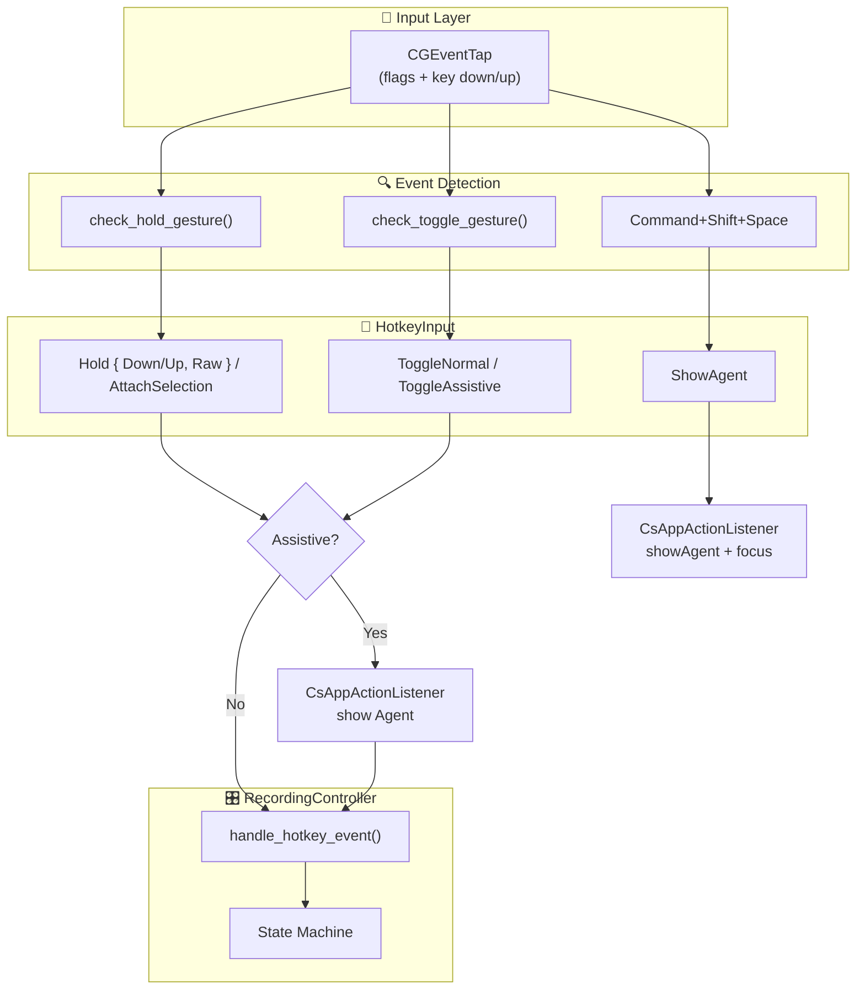
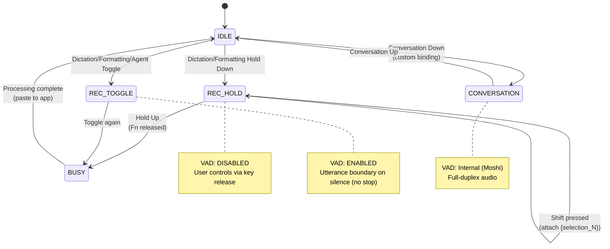
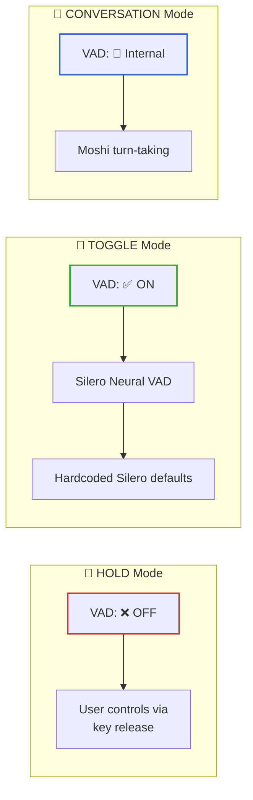
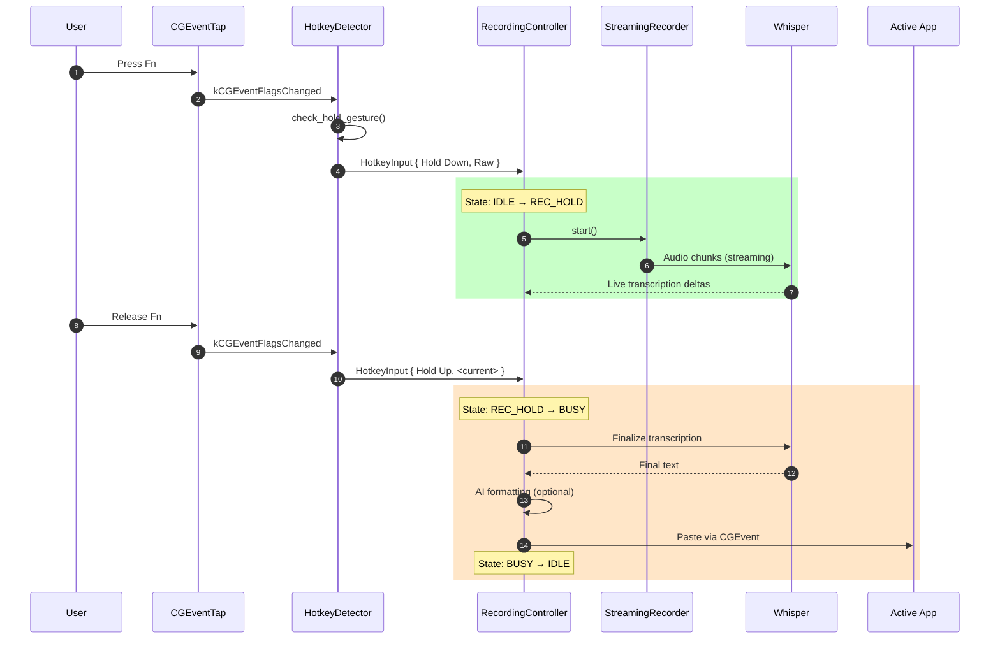
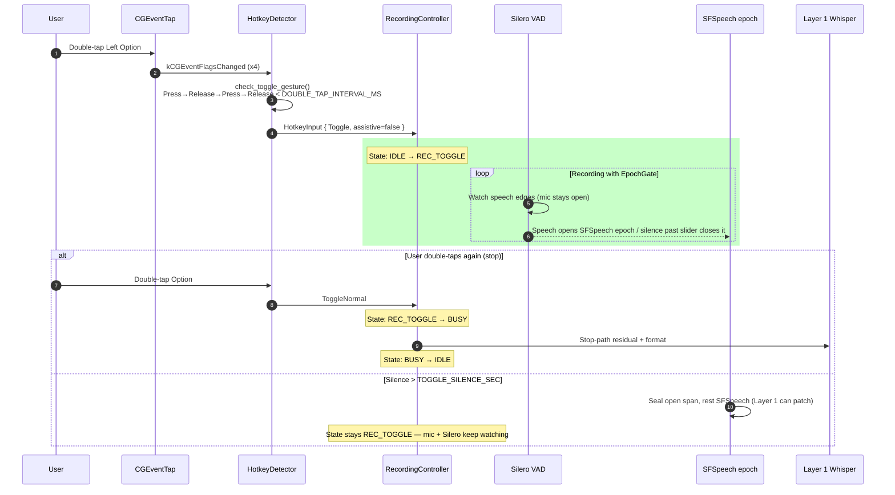
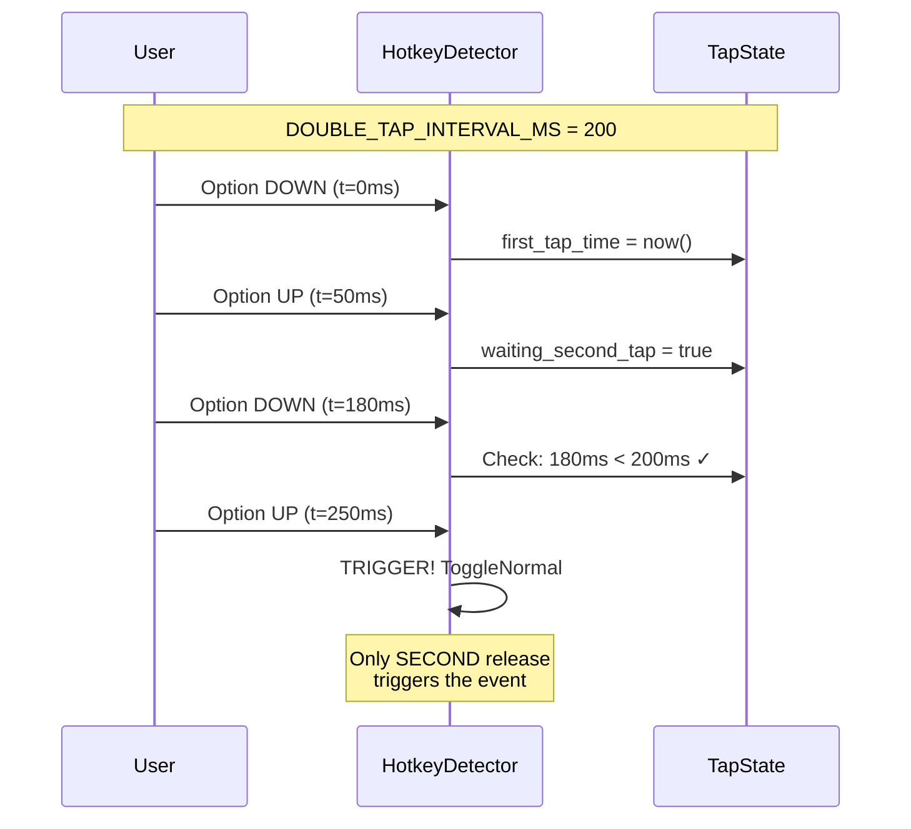

# Hotkeys Contract

## Overlay conversation viewing and speech

The channel map in mini and compact is opt-in in Settings → Creator →
**Channel map in the overlay**, off by default. With it off, mini keeps `cs` and
its earlier 200 × 46 pt size (164 × 46 while an agent records); compact's natural
width is 410 pt. An explicit user resize stays respected. The map geometry below
applies when that switch is enabled. The switch changes presentation only.

Overlay size is selected explicitly. Each ordinary preview-button click advances
mini → compact (midi) → regular (full transcript) → mini. The upper-right corner
is the shared pin: the strip grows leftward and the transcript grows downward,
with display containment applied when the full target cannot fit. The context
menu also selects any of the three modes directly. Mini is not resizable and is
as wide as its content; midi supports horizontal resize; regular supports edge
and corner resize around that same pin. Settled native floors are mini
130 × 46 pt (its controls), midi 410 × 46 pt and regular 320 × 260 pt. Screen
anchors, the saved position and resize gestures reason in a 200 × 46 pt mini
placement strip (`DictationOverlayWindow.miniPlacementSize`); mini is drawn at
that strip's trailing edge. During a drag, the painted frame respects the current form's floor.
The panel separately retains the requested gesture size: on release, requested
height of at least 153 pt selects regular; below that, requested width below
305 pt selects mini and larger width selects midi. Thus release-to-fold remains
available without crushing the current presentation during the drag. Compact
forms settle to their strip sizes; regular retains its manual size above its
readability floor. Moving the window relocates the pin. Pointer entry
and departure preserve that selection. Hover still provides button feedback and
pauses terminal auto-hide; it does not change the capture route or window size.

Mini and compact carry the channel map (`docs/guide/chat-overlay.md`, "Channel
map in the collapsed overlay"). Mini's header is the brand dot, the channel
counter, the agents button, the microphone and the form control; it no longer
reads "cs". Mini is as wide as its content (`DictationOverlayWindow.miniNaturalWidth`):
its 130 pt floor (32 pt padding, the 9 pt dot, two 4 pt gaps around the closed
centre, 81 pt of trailing controls) plus, with a channel on the map, 6 pt and
the counter as drawn, the agent count with `▾` or the open channel's digit with
the violet open-channel dot. It resizes in one step at its upper-right pin when the
counter changes, opening and closing a microphone included; there is no
separate width while an agent records. No two neighbouring controls stand
further apart than the 8 pt between the trailing controls.
Compact's map sits between the session timer and the header actions. The
46 pt height, the 410 × 46 pt compact floor and the fold control's point are
unchanged. Compact's natural width (`DictationOverlayWindow.midiNaturalWidth`)
is that floor plus the map's gap, room for channel 0's digit chip (shown only
while the microphone broadcasts) and the row of the first tier that fits the
820 pt budget (`midiChannelMapBudget`, two floors): named chips, else
digit-only chips with room for the selected conversation's name. The screen's
visible width remains only a last cap; with no agent bound it is the floor.
The floor already holds the header's level meter (its 56 pt
`waveformMinWidth`) and the session timer, which compact lays out at rest as
well as during a take, so starting a take changes neither the strip's width
nor its chips' tier.
Entering compact lands on it, and a roster change while compact is shown (an
agent bound, archived or renamed) resizes the strip in one step at its
upper-right pin, with display containment as for any morph; opening or closing
a microphone, channel 0 included, does not. A manual horizontal resize gives
the width to the user for the session: narrower than the natural width, it is
kept and roster changes no longer resize the strip (the chips drop to digits
or the counter); wider, it is kept and grows only when the natural width
exceeds it. A map that cannot fit even its counter claims no width. Its
shortcut hints read the Agent channel modifier from settings
(`AGENT_CHANNEL_MODIFIER`, Ctrl or Fn) and never assume Ctrl. A chip click is
passive selection, like a rail pill. The counter click changes form or width
only: in mini it selects compact, as the form control's "Expand to compact
widget" does; in a compact strip the user narrowed it forgets that width so
the strip settles to its natural width. Neither ever opens or closes a
channel's microphone or retargets a running capture. The map adds no hotkey
and no chord of its own.

The overlay's channel menu separates **My dictation**, **0 · All**, and exact
named-agent conversations from the explicit **Capture channels** controls.
Selecting a conversation is passive: it does not open or close the microphone,
change an admitted take's destination, acknowledge an envelope, or replay speech.
Historical conversations retain their provider/session/lease identity and name
after rebinding. Channel 0 remains viewable when capture is closed.

My dictation keeps its native editor mounted across view changes, retaining its
selection, scroll and local revision draft. A view change cancels pending
commit-on-blur admission; explicit transcript actions still use the existing
reducer compare-and-swap path. Conversation messages are selectable read-only
text. Unread reply counts describe viewing only, independently of delivery ACK.

An explicit ordinary hold or toggle start closes active agent capture channels
through their normal hangup path before admitting dictation (Founder delivery
`f3cbd666a0d7d7e61d4d1971`, 2026-10-05).
Each channel releases its PCM feed before dictation admission. Its retained
terminal task then joins and publishes the final receipt; its words are retained.
For hold gestures, handover waits until the existing start delay has elapsed.
The modifier alone can still become a channel chord or be released without a
take; an explicit channel gesture cancels that pending ordinary hold.
When the hold's base key is also the agent-channel modifier (`HoldFn` with
`AGENT_CHANNEL_MODIFIER=fn`, `HoldCtrl` with `ctrl`) and a channel is open,
the elapsed delay admits nothing: the hold stays the chord's prefix, the
channel survives, no hang-up receipt is written, and the digit chord is the
only way to close it (Founder, 2026-10-22: a Fn held past the delay before the
digit hung up the channel, the digit reopened it, and the reopened microphone
fed Whisper silence). Dictation on that key starts only once no channel is
open; the toggle gestures and the other hold presets are unaffected.
With no channel open, the same hold can already be admitted (`RecHold`) when
the digit arrives. An explicit channel gesture then ends that take as the
chord's prefix before the channel opens (Founder, 2026-10-23: the key-up after
such a chord pasted a stray word into the terminal). The rule covers only a
non-assistive Raw hold whose base key is the channel modifier, the same pairs
as above. The recorder's discard stop releases the take's capture under the
serial transition lock; nothing is pasted, copied, routed or sent to an agent,
no session archive is written, and the Bus session ends with
`end_reason: chord_prefix` (phase `no_speech`, every overlay action off), which
the overlay receives as its lifecycle terminal. The controller is Idle again,
so the later key-up is a no-op. Holds on another key, assistive holds and
toggle takes keep running beside the opened channel as before.
The same unified overlay then shows My dictation. Channel auto-reopening shares
the controller's serial transition lock with this handover. Repeated lifecycle
callbacks do not replace a view the user selected during the admitted capture.

A recording Stop gesture binds the already published capture identity before
waiting for the start transition lock. Key release, the overlay Stop and the
recording toggle join the same retained terminal operation. A start finishing
its admission cannot discard that Stop; timeout leaves its owner running until
settlement. The terminal operation rechecks the captured identity under the
transition lock and never stops a successor. Idle without a published capture
still requires admission to be available before reporting no live take.

Native recording gestures remain FIFO ordered through capture admission. A Stop
acknowledges only after its PCM subscription is released and the capture and
transition locks are free. The same retained terminal operation owns archive
finalization, recognition, reducer publication and delivery; explicit Stop APIs
still wait for its terminal result. `Busy` refuses a new take until the old
foreground retires, while channel gestures can use the released capture slot.
A preempting start waits on the predecessor's foreground settlement receipt,
not merely on a mutex that the terminal drain has released.

Each take archives exactly its own admitted native PCM, even when a channel
keeps the physical microphone open. Releasing the feed freezes its sample count
under the same registry lock as capture admission. A bounded archive queue or
write failure refuses incomplete evidence; it never certifies a shortened WAV.

Each reply's **Play** invokes the installed bus speech owner with its persisted
reply ID and a fresh playback ticket. **Stop** names the exact emitted active
ticket and provider session. These controls do not use the built-in chat player.
The existing voice profiles, microphone interlock and serialization apply;
failed or refused speech leaves reply text visible. Conversation selection never
schedules historical replay or starts extra offscreen sound.

The per-agent speaker controls automatic playback for the exact provider/session
and bus. A manual Play is still explicit while that agent is muted. The channel-0
speaker is the global playback switch: it also covers manual playback and future
channels, without rewriting individual preferences. The UI confirms a change by
reading the playback owner's durable receipt; an error is not a confirmed mute.
The reported save failure remains open as of the 801 UI source cut.

On macOS 15+, the conversation's native size-change scroll anchor owns resize
anchoring; geometry changes do not also issue a proxy scrollTo. macOS 14 keeps
the proxy path. Explicit return-to-current and new-message following remain
separate from resize. This source change does not certify absence of transient
flicker on a live window.

Opening a capture channel follows the exact provider/session conversation and
scrolls to its newest message. In mini and compact with the channel map on
(Creator preference `codescribe.overlay.channel_map`), the chord keeps that
form: the conversation is selected, the strip's chip or counter shows the open
digit, and the overlay does not unfold onto the Agents canvas. With the map
off, or when the overlay is already expanded, the Agents canvas unfolds onto
the conversation (the overlay's expand-by-default preference permitting).
Incoming replies, a dictation take start and the preferred expansion keep
their own rules. New messages on that open channel keep the latest
entry visible; a passive roster poll does not replace a manually selected thread.
The newest messages are painted first without reordering the observer history.

The channel digit chord is claimed by the CoreGraphics tap: down, repeat and up
are consumed, including an up after modifier release. Ordinary typing, other
shortcuts and mouse events still reach the frontmost app. A successfully opened
live channel plays **Pop**, respecting Start sound and its configured volume.
A rejected open, a close or automatic phrase reopening does not play that cue.

Each named conversation has a written-message composer. Clicking it takes the
existing overlay keyboard gate; opening a voice channel never steals keyboard
focus from the dictation destination. **Send** publishes an explicit typed
message to the selected immutable provider/session/lease. Rebinding or a missing
listener refuses publication and keeps the draft. Publication is separate from
queue acceptance and the agent's acknowledgment; successful publication clears
only the submitted draft, preserving text entered while the request was pending.

> Technical specification for codescribe hotkey system.
>
> Created by Vetcoders (c)2026

---

## Overview

Codescribe uses a low-level CGEventTap to detect modifier-only keypresses on macOS.
This approach avoids TSMGetInputSourceProperty crashes on macOS 26.2+ (Sequoia).

Canonical hotkey configuration is **mode-first**:

- `Dictation`, `Formatting`, and `Assistive` each own one `ShortcutBinding`
- bindings are persisted in `~/Library/Application Support/Codescribe/settings.json`
- legacy `.env` hotkey keys such as `HOLD_MODS` / `TOGGLE_TRIGGER` are no longer part of the runtime contract
- fixed application commands are a separate, non-configurable command plane and never become `WorkMode` bindings

### Agent summon command (not a recording mode)

`Command+Shift+Space` emits one `HotkeyEvent::ShowAgent` per physical Space
press. The bridge delivers it to `CsAppActionListener`, which fronts the single
existing Agent window and requests composer focus. This route does not construct
or call `RecordingController`, publish `on_recording_preparing`, create a thread,
send a payload, or change the Idle state. Key-up re-arms the chord so macOS key
repeat cannot emit duplicate commands.

This fixed MVP chord is intentionally outside the configurable
`WorkMode -> ShortcutBinding` contract.

The widget chord (`WIDGET_SHORTCUT`, default `ctrl+shift+b`; Founder,
2026-10-23: "B jak bus", and the user names their own) emits one
`HotkeyEvent::ToggleWidget` per physical press of its key. The chord is any
combination of Control, Option, Command and Shift plus one letter or Space,
with at least one of Control, Option or Command (a plain or Shift-only letter
types) and never `Command+Shift+Space` (the Agent summon above). Digits stay
channel chords and Fn stays dictation, so neither can end the chord. The core
(`WidgetShortcut`, core/config/types.rs) parses, validates and labels it; the
detector matches the key with exactly those modifiers held and Fn up; the
runtime atomics live-reload it on every settings write like the channel
modifier. The bridge delivers the event to
`CsAppActionListener::on_toggle_widget`; the overlay decides what it means: a
hidden panel shows as the Tray's **Show widget** does, a visible idle panel
hides through the human Close intent, and a panel that is recording or holds an
open channel only comes forward — the chord never hides live capture. Like
`ShowAgent` it touches no `RecordingController`, no lifecycle callback and no
Idle state, and key-up re-arms it against key repeat. The tap does not claim
the event, so a host app or Cocoa binding on the same chord (the default's
`^⇧B` extends a text selection one character back) still sees it; the hold
presets whose base is Ctrl+Shift are unaffected because the chord needs its
key, which any hold start already treats as a key press during the modifier.
Settings › Shortcuts › Extra shortcuts shows the chord as a pill: a click arms
the recorder, the next key press becomes the chord, Escape keeps the old one,
and a refused press keeps it and says why. The recorder mirrors the core's
rules (`WidgetShortcutChord`, WidgetShortcutRecorder.swift) and the core
refuses the write again on its own.

Assistive bindings notify the same app-action plane to front/focus the Agent
window, then deliver the recording event to the same `RecordingController` as
Dictation. Agent, Assistive, and Dictation therefore share microphone, VAD, STT,
committed-text correction, and transcript publication. Only downstream UI and
delivery differ. Assistive keeps the Dictation overlay closed; a process-wide
start gate prevents any competing recorder from opening.

### Agent composer mic (a capture gesture, not a hotkey)

The composer microphone button is **not** an assistive toggle. Until
rc-w2-composer-turn it called `start_assistive_recording`, so the take inherited
the hands-free lane wholesale: trailing silence past `toggle_silence_sec` closed
an utterance epoch, and each sealed fragment could open its own paid formatter
slot. A two-minute composer take therefore behaved as a stream of five-second
epochs with several provider calls behind it.

The composer now calls `CodescribeHotkeys.start_composer_turn_recording`, which
carries a per-take `CaptureTurnIntent::SingleTurn` from the button, through the
bridge, into the controller's pipeline configuration. Everything else is shared:
one `RecordingController`, one recorder, one `AcousticLedger`, one
`PresentationEmitter`. What differs is exactly two facts:

- **Epochs.** `CaptureTurnIntent::SingleTurn` asks the recorder for
  `utterance_silence_sec: None` — the pipeline's legacy contract of one
  continuous stream for the whole take. Silence never ends the take; only an
  explicit stop does. This rests the _engine lifecycle_, not the VAD: Silero
  segmentation, ledger qualification and Layer 1 tail repair run unchanged.
- **Formatting.** The live per-occurrence formatter lane is never armed for a
  one-turn take (`live_formatter_lane_is_armed`), so no silence-delimited
  fragment can reserve a provider slot. The turn is instead formatted once at
  terminal processing, through the same
  `terminal_revision_source` → provider → `apply_formatter_revision` corridor as
  the explicit overlay formatter. An empty turn issues no request at all.

Ownership is a composer fact, not a global one. `AgentChatStore` latches
`dictationThreadID` at the gesture; the composer press stops only a take it
owns. A live hotkey, tray or overlay dictation reads as busy and is never ended
by a composer press. `ToggleNormal`, `ToggleAssistive` and both hold gestures
keep `CaptureTurnIntent::HandsFree` and their existing behaviour; the intent is
reset to hands-free between takes, so a composer turn cannot leak into the next
hands-free one.

**Thread routing (operator contract 2026-08-13).** An assistive turn always
lands in the thread the Agent rail currently has selected — the thread the
user is looking at. The rail publishes every selection change through
`CodescribeHotkeys.set_assistive_target_thread`; the controller rebinds its
runtime (rejoin + rehydrate) when the target differs from the bound thread. A
new thread is only ever minted by an explicit "New conversation" (published as a
`nil` target, consumed once — one press mints one thread, not one per
utterance). If the Agent UI never published a selection (window never
opened), the lane continues its bound conversation as before.

**Delivery destination (operator contract 2026-08-15).** The hotkey picks the
_intent_; it does not paste into the frontmost app. `resolve_delivery_route`
(`docs/DELIVERY_ROUTE.md`) is the only destination function:

- Assistive hold → Agent composer (first-class message, never Cmd+V)
- Hold Fn / Globe → Orient canvas, plus auto-paste **only** into the app
  latched at key-down — never into Codescribe itself
- Overlay **To Agent** → Agent composer, even after the session reset

Focus at stop time is not an input. A tagged `<codescribe mode="raw">` paste
into the Agent composer is a doctrine violation.



---

## Modes

### 1. Hold Mode (Push-to-Talk)

**Trigger:** Press and hold configured modifier combo
**Behavior:** Recording starts on key down, stops on key up
**VAD:** DISABLED - user has 100% control via key release

| Mode binding              | Keys         | Use Case                         |
| ------------------------- | ------------ | -------------------------------- |
| `Dictation=HoldFn`        | Fn           | **Default** (best for terminals) |
| `Dictation=HoldCtrl`      | Ctrl         | Terminal-heavy users             |
| `Dictation=HoldCtrlAlt`   | Ctrl+Option  | Power-combo preset               |
| `Dictation=HoldCtrlShift` | Ctrl+Shift   | Alternate hold dictation         |
| `Dictation=HoldCtrlCmd`   | Ctrl+Command | macOS power users                |

Fn hold-down (Raw) captures any live OS selection once as `{selection_1}`.
Mid-hold Shift (or the configured arm modifier, default Shift, optional
Command) attaches further pulses as `{selection_2..n}`. Neither upgrade
`HoldMode` to Chat, fronts Agent, hides the overlay, or stops the Fn take.
The controller sends those authenticated captures into `TranscriptReducer` at
their document positions. The reducer renders and anchors the markers in the
projected document; the Swift overlay only displays the resulting projection.

Fn+Shift from idle is dictation, not Assistive. Voice chat is the Assistive
work-mode binding (default: double-tap Right Option), not Hold Fn+Shift.

**Events:**

```rust
HotkeyEvent::Hold { action: Down, mode: Raw }   // Fn, or Fn+Shift from idle
                                                // (controller attaches live selection)
HotkeyEvent::AttachSelection                    // Shift/Command rising edge mid-hold
HotkeyEvent::Hold { action: Up, mode: Raw }     // Release — destination stays Raw
```

**Engine and delivery parity:** Hold and toggle both start
`StreamingRecorder::start_event_session` and fan the same `EngineEvent` stream
through `PresentationEmitter`, IPC, and telemetry sinks. Their intentional
difference is boundary policy (key-up for hold, VAD for toggle), not the STT
engine. A late `Correction` patches the active preview or the matching most
recent committed utterance; it must never create a second delivered utterance.

---

### 2. Toggle Mode (Hands-Free)

**Trigger:** Double-tap Option key within `DOUBLE_TAP_INTERVAL_MS` (default **200ms**, range 100–450ms)
**Behavior:** First tap starts recording, second tap toggles send/stop
**Tap means tap:** an Option press counts as a tap only when it is shorter than
220 ms (`TAP_MAX_MS`, the same limit the Ctrl double-tap uses) and nothing was
typed while it was down. Typing with Option (Polish diacritics such as ś, ć, ę)
never pairs into a double-tap: the detector drops the pair when it saw a letter
key-down, and also when the HID system reports a key-down during the press even
though the tap never received the letter (secure keyboard entry, another event
tap swallowing key events). The CoreGraphics layer passes that HID timestamp
in through `HotkeyDetector::observe_hid_key_down` on every modifier change.
Both ends of the press are timed by the CGEvent timestamp (the hardware clock),
not by when the tap callback ran, so a late callback cannot shrink a chord into
a tap. Verified so far: the detector logic (unit tests) and the gates; still to
be verified at runtime: that the HID key-down query is populated under secure
keyboard entry, and that ordinary double-taps stay comfortable.
**Silence:** ENABLED – `TOGGLE_SILENCE_SEC` (default 5s) is the Apple engine lifecycle on the live
lane (`EpochGate` in `apple_live_session.rs`): Silero watches the mic, speech opens an SFSpeech
epoch, silence past the slider seals the span and rests the engine, the next speech edge wakes a
fresh epoch. Recording does not stop. This is not a wav-only chunker knob and not `CODESCRIBE_VAD_*`.

| Mode binding                  | Keys                         | Mode              |
| ----------------------------- | ---------------------------- | ----------------- |
| `Formatting=DoubleLeftOption` | Left Option double-tap       | Formatting        |
| `Assistive=DoubleRightOption` | Right Option double-tap      | Assistive         |
| `Dictation=DoubleCtrl`        | Ctrl double-tap              | Raw dictation     |
| `Disabled`                    | no toggle for that work mode | Hold-only profile |

Formatting is orthogonal to the trigger and destination. Hold, normal toggle,
and assistive sessions all honor the session's Auto Format setting. The trigger
chooses semantics and destination; it does not remove formatting capability.

**Stop latency trade-off (supersedes ADR 2026-05-28 Faza 1 force-RAW):** with
formatting enabled in Settings, a hands-off toggle stop performs one AI
formatting call on the stop path before delivery. This latency is the user's
explicit choice, not a surprise: the overlay reports the phase as `final pass`
while the call runs, a formatting failure falls back to the post-processed raw
text, and users who want a zero-latency stop either disable the formatting
default or use a `Dictation` binding (force raw). The earlier unconditional
force-RAW on this path was removed because it silently erased the Settings
formatting default.

**Revision D-01 (2026-07-16):** commit `37f137e` intentionally reverted the
2026-05-28 ADR decision that forced toggle hands-off stops to RAW whenever no
explicit hotkey override existed. The runtime now lets Settings decide the
default route in that case, while explicit `Dictation` / `Formatting` bindings
continue to win.

**Events:**

```rust
HotkeyInput { key_type: Toggle, action: Press, assistive: false } // Left Option
HotkeyInput { key_type: Toggle, action: Press, assistive: true }  // Right Option
```

### Settings picker vs routed combinations

The Shortcuts tab offers one flat gesture catalog for all three modes:
`available_bindings()` returns every `ShortcutBinding` regardless of mode
(`bridge/src/hotkeys.rs`). The detector routes a subset of those cells, and
that subset is one predicate, `mode_binding_reachable(mode, binding)` in
`app/os/hotkeys/detector.rs`:

| Work mode  | Routed gestures                | Routing site in `HotkeyDetector::handle_flags_changed`                                             |
| ---------- | ------------------------------ | -------------------------------------------------------------------------------------------------- |
| Dictation  | all five `Hold*`, `DoubleCtrl` | hold combo (`check_hold_combo`), raw toggle (`dictation == DoubleCtrl`)                            |
| Formatting | `DoubleLeftOption` only        | normal toggle (`formatting == DoubleLeftOption`) — the only read of `mode_bindings.formatting`     |
| Assistive  | `DoubleRightOption` only       | assistive toggle; `assistive_hold_binding` maps no hold to Assistive, so every `Hold*` is unrouted |

`Disabled` binds nothing and is accepted for every mode. The routed sets are
disjoint: a gesture bound to two modes always leaves one of them unrouted.
`reachability_predicate_matches_detector_routing_for_every_cell` (detector
tests) binds each of the 24 mode × gesture cells alone, performs the gesture
through `HotkeyDetector::feed` with synthetic key snapshots, and asserts that
the predicate and the started mode agree — 8 routed cells, 16 unrouted.

The routed set describes each cell **bound in isolation**. The per-cell
predicate is not the whole routing decision: one cross-mode rule also reads the
Dictation binding. With Dictation=`DoubleCtrl` the raw toggle wins and both
Option toggles start nothing, so Formatting=`DoubleLeftOption` and
Assistive=`DoubleRightOption` are routed cells that are still blocked.
`detect_internal_conflicts` (`app/os/shortcut_registry.rs`) reports that pair
as a blocking conflict ("Dictation is set to Double Ctrl, so Left/Right Option
toggle is disabled."), which is the sentence the `ShortcutsSaveReceiptTests`
assert; the precedence matrix below lists the same rows.

**Unrouted cells are refused, not persisted.** One owner, three readers:

- Validation: `detect_internal_conflicts` (`app/os/shortcut_registry.rs`)
  emits a blocking conflict for every bound mode the detector does not route,
  through `unreachable_binding_message`. The sentence names the one mode the
  gesture does start — the explicit precedence. Settings gates Save on it.
- Write: `set_mode_binding` (`bridge/src/hotkeys.rs`) refuses the same cells
  with the same sentence, for Settings, onboarding and any other caller, so no
  path persists a dead binding.
- Screen: `HotkeysPresentation.swift` maps each wire sentence to a localized
  one (PL/EN) and keeps the wire text as the technical line. Swift holds no
  routing table of its own.

**Precedence matrix (what one physical gesture starts):**

| Bound configuration                                           | Gesture         | Starts                    | Settings                                                       |
| ------------------------------------------------------------- | --------------- | ------------------------- | -------------------------------------------------------------- |
| Dictation=`DoubleLeftOption`, Formatting=`DoubleLeftOption`   | 2× left Option  | Formatting only           | blocking: "This gesture only starts Formatting, so Dictation…" |
| Dictation=`DoubleCtrl`, Formatting=`DoubleLeftOption`         | 2× left Option  | nothing (raw toggle wins) | blocking: "Dictation is set to Double Ctrl, so Left Option…"   |
| Dictation=`DoubleCtrl`, Assistive=`DoubleRightOption`         | 2× right Option | nothing (raw toggle wins) | blocking: "Dictation is set to Double Ctrl, so Right Option…"  |
| Dictation=`Hold*`, Assistive=same `Hold*`                     | that hold       | Dictation only            | blocking: "This gesture only starts Dictation, so Assistive…"  |
| Formatting=`HoldCtrl` (no duplicate)                          | hold Ctrl       | nothing                   | blocking: "This gesture only starts Dictation, so Formatting…" |
| Defaults: `HoldFn` / `DoubleLeftOption` / `DoubleRightOption` | each            | its own mode              | clean                                                          |

The macOS Fn/Globe tap note (`fn_tap_intercept_note`) is informational: it
crosses the bridge with `blocking: false` and never blocks Save.

A settings file written before this rule can still hold an unrouted cell. The
Shortcuts tab shows it as a blocking conflict on load; choosing a routed
gesture for that mode clears it.

Narrowing the picker itself per mode needs a per-mode `available_bindings`
query on the bridge (a UniFFI shape change, regenerated bindings). Until then
the picker offers every gesture and the backend refuses the unrouted ones
inline, before Save.

### Capture and transcript ownership

Every speech mode enters one `RecordingController`:
capture → VAD → STT → `PresentationEmitter` committed reducer. Dictation and
Formatting then paste or format; Agent and Assistive deliver to the selected
Agent thread. The clean NDJSON transcript bus observes the committed reducer,
before any consumer-specific action, and never opens audio or re-transcribes.

Selection is captured in the trigger handler, never at send time. Rust remains
the indicator/tray authority, while the transcription overlay is exclusive to
Dictation and Formatting.

After capture completion, retained reducer text is editable in the same native
canvas even when coverage is refused or a later document observation is
nonterminal. Document observations cannot reopen that capture; new controller
admission resets completion and retires the outgoing session. Live compact
preview stays read-only and is never promoted into an editable document.
Typing remains a local draft until the existing authenticated revision owner
accepts it. Blur, late observations, pending or rejected commits keep those
bytes; a successor capture moves unsaved edits to the existing recovery owner.
Editing alone grants no seal, microphone admission, Agent send or delivery right.

---

### 3. Conversation Mode (Moshi Full‑Duplex) — experimental

Conversation mode exists in the controller, but **has no default hotkey binding** in the current release.
If you wire a custom trigger, it runs full‑duplex audio (mic → Moshi → speaker) and uses Moshi’s internal
turn‑taking. Requires Moshi models at `~/.codescribe/models/moshiko-q8/`.

---

## State Machine



**States:**

- `IDLE` - Waiting for hotkey
- `REC_HOLD` - Recording (hold mode, no VAD)
- `REC_TOGGLE` - Recording (toggle mode, VAD active)
- `BUSY` - Processing transcription/AI formatting
- `CONVERSATION` - Moshi full-duplex active

---

## VAD Behavior Contract



| Mode             | VAD Segmentation | Reason                                                             |
| ---------------- | ---------------- | ------------------------------------------------------------------ |
| **Hold**         | ✅ YES           | VAD segments utterances; user controls start/stop via key release. |
| **Toggle**       | ✅ YES           | Hands-free mode uses utterance boundaries (no stop).               |
| **Conversation** | Internal         | Moshi handles turn-taking internally.                              |

---

## Environment Variables

### Hotkey Configuration

Bindings themselves are persisted in `settings.json`.
The remaining runtime env surface only tunes detector behavior:

| Variable                 | Default | Options         | Reload               |
| ------------------------ | ------- | --------------- | -------------------- |
| `HOLD_EXCLUSIVE`         | `false` | `true`, `false` | RESTART              |
| `HOLD_START_DELAY_MS`    | `800`   | 0-1000          | RESTART              |
| `DOUBLE_TAP_INTERVAL_MS` | `200`   | 100-450         | RESTART              |
| `TOGGLE_SILENCE_SEC`     | `5.0`   | 0.5-30.0        | HOT (next recording) |

### VAD Configuration

VAD internals are hardcoded in `core/vad/config.rs` (no runtime env knobs).

---

## Event Flow

### Hold Mode (Push-to-Talk)



### Toggle Mode (Hands-Free)



### Conversation Mode (Moshi Full‑Duplex)

Conversation mode is available in the controller but **not bound to a default hotkey** in the current release.
Wire it manually if you need full‑duplex audio (mic → Moshi → speaker).

---

## Implementation Notes

### CGEventTap (macOS)

```rust
// Speech gestures read CGEventFlags. Fixed command chords additionally read
// the layout-independent virtual keycode (Space = 49); no keyboard layout APIs.
let flags = CGEventGetFlags(event);
let ctrl = (flags & kCGEventFlagMaskControl) != 0;
let alt = (flags & kCGEventFlagMaskAlternate) != 0;
// etc.
```

**Why:** TSMGetInputSourceProperty (used by rdev/global-hotkey) crashes on macOS 26.2+ when called from event tap callback thread.

### Double-Tap Detection



```rust
const DOUBLE_TAP_INTERVAL_MS: u64 = 200;

// Sequence: Press → Release → Press → Release (within interval)
// Only the SECOND release triggers ToggleNormal/ToggleAssistive
```

### Exclusive Mode

When `HOLD_EXCLUSIVE=false` (default), modifier variants work out of the box:

- Shift or Command _during_ an already-started Fn hold attaches `{selection_N}`
  (default arm modifier Shift; configurable to Cmd in Settings)
- Fn+Shift from idle stays dictation — it is not Assistive and does not front Agent
- The unconfigured arm modifier does not attach (W10-B detector truth)

Set `HOLD_EXCLUSIVE=true` when you need stricter isolation:

- Option taps are ignored if Option is part of an unrelated hold combo
- Prevents accidental toggle while trying to hold legacy Ctrl-based combos

---

## Troubleshooting

| Symptom                                           | Cause                                      | Fix                                                           |
| ------------------------------------------------- | ------------------------------------------ | ------------------------------------------------------------- |
| Hotkeys don't work                                | Accessibility permission denied            | System Settings → Privacy → Accessibility → Enable codescribe |
| Double-tap too sensitive                          | Interval too short                         | Increase `DOUBLE_TAP_INTERVAL_MS` (100–450ms)                 |
| Recording won't stop (hold)                       | Key stuck in system                        | Release all modifiers, try again                              |
| VAD cuts utterance too early                      | VAD defaults too conservative              | Tune constants in `core/vad/config.rs` and rebuild            |
| Double-tap / arm “does nothing” with no UI change | Gesture blocked or arm ignored at detector | Check INFO logs for stable diagnostic lines (below)           |

### Blocked / ignored gesture diagnostics (INFO)

Every blocked double-tap and ignored arm attempt emits one **INFO** line with a
stable `reason=` token (visibility only — routing is unchanged). Filter
`~/.codescribe/logs/codescribe.log` (or the Diagnostics surface) for:

```text
blocked_double_tap gesture=left_option|right_option reason=binding_disabled|modifier_combo_active
arm_ignored reason=wrong_arm_modifier
```

| Log line                                            | Meaning                                                                      |
| --------------------------------------------------- | ---------------------------------------------------------------------------- |
| `blocked_double_tap … reason=binding_disabled`      | Double-tap recognized, but that Option side is not assigned to a mode        |
| `blocked_double_tap … reason=modifier_combo_active` | Double-tap recognized while another modifier/hold combo is active            |
| `arm_ignored reason=wrong_arm_modifier`             | Hold base is down, but the non-configured arm key (Shift vs Cmd) was pressed |

If **no** such line appears when you double-tap or arm, the OS never delivered
the key event to Codescribe (permissions / focus / hardware) — that case is
outside the detector.

---

## File Locations

| File                               | Purpose                             |
| ---------------------------------- | ----------------------------------- |
| `app/os/hotkeys/detector.rs`       | Pure speech/command event detection |
| `app/os/hotkeys/platform.rs`       | CGEventTap adapter and keycodes     |
| `bridge/src/hotkeys.rs`            | Recording and app-action routing    |
| `app/controller/mod.rs`            | State machine, event handling       |
| `app/controller/types.rs`          | State enum                          |
| `core/vad/config.rs`               | VAD configuration                   |
| `core/audio/streaming_recorder.rs` | Silero VAD segmentation             |

---

_Copyright © 2024–2026 Vetcoders_

### Publication timeout ownership

A foreground terminal-publication timeout is an incomplete attempt, not a Bus end.
The original `ClosedTake`, presentation sink, exact Bus and retention lease move
into the controller's tracked closed-capture tails before foreground reset. The
tail retries publication with backoff and classifies/archives/ends only that take
after acknowledgement. It cannot paste, paint, or reset a successor. Permanent
publisher refusal remains unfinished and visible to shutdown admission; timeout
never grants permission to discard unpublished terminal evidence.

Recording start opens regular when the default transcript preference is enabled,
and MIDI when disabled. MINI is the idle entry form; merely changing form does
not start or stop recording.
